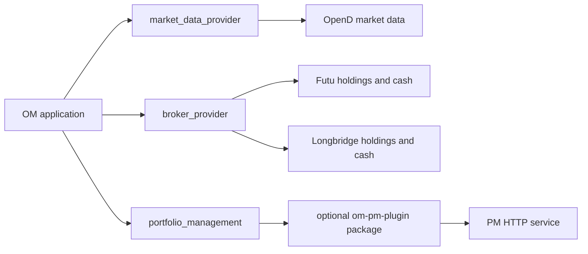

# Architecture

`options-monitor` is an operations-sensitive local application. The code is
organized around stable entry points, application use cases, deterministic
domain rules, external adapters, and local state repositories.

## Layers

| Layer | Path | Owns |
|---|---|---|
| Interfaces | `src/interfaces/` | Human CLI, Tool Gateway, and Inbound Bot request/response adaptation |
| Application | `src/application/` | Use-case orchestration, config assembly, pipeline execution, notification flow |
| Domain | `domain/domain/` | Deterministic strategy, scheduler, notification, position, and schema decisions |
| Infrastructure | `src/infrastructure/` | OpenD/Futu, Feishu, WeChat ClawBot, exchange-rate and subprocess adapters |
| Storage | `domain/storage/` | Local path conventions and repository-style reads/writes for run state and reports |

Rules:

- `domain/domain` must not import `src` or `scripts`.
- `src/application` must not import `scripts`.
- `scripts/` is reserved for operational wrappers, release helpers, diagnostics,
  and one-off tools that delegate into `src` or `domain`.
- Public behavior should enter through `./om` (including `./om tools`; compatible `./om-agent`), or
  documented `python -m src.application...` entry points.

## Optional capabilities and providers

OM keeps strategy, ledger, evidence qualification and risk calculations in core.
External capabilities enter through three boundaries:



- Market data uses `market_data.provider` (default/current package: `market-opend`, provider `opend`).
  Required-data planning, prefetch, ordinary scan fetches and interactive option
  queries resolve the same capability owner. Provider failures retain their
  failure, timeout and cancellation semantics; selection does not grant broker
  account access. Legacy standalone OpenD subprocess commands remain OpenD-specific.
  Selected provider source identity also binds required-data plans, cache metadata,
  frozen consumers and quote receipts; switching providers invalidates prior data.
  Non-OpenD status snapshots use the canonical `market_data` capability and retain
  the actual provider in `payload.source`, without a fallback status label.
  Default OpenD evidence retains its historical source aliases and receipt format.
  Tick readiness probes OpenD quotes only when selected, and checks each actual
  installed Futu broker independently with its account/environment binding. Phone-verification
  state gates only runs needing either capability. The tick trading-day query uses
  the selected provider; unavailable calendars retain the existing unknown-day policy.
- Broker assets use `account_settings.<account>.type` in generated config
  (`accounts.<account>.type` in YAML). `portfolio.source: auto` selects `futu` or
  `longbridge` for that account. Explicit mismatches fail without another broker
  fallback. The optional `broker-futu` and `broker-longbridge` packages own account
  access; zero broker packages is valid. Current portfolio loading checks package
  availability before accepting caches. Missing capability stays unavailable, while
  market analysis and historical evidence readers remain available. Generic identity comes from `risk_capacity.broker_capacity_binding`;
  existing OpenD v1 identity and historical candidate snapshots remain valid.
- PM transport lives in the separately installed `om-pm-plugin` package under
  `plugins/portfolio-management`; core owns its shared exceptions and evidence
  validators in `portfolio_management_contract.py`. Disabled PM never loads the
  package. Missing enabled integration reports `PORTFOLIO_MANAGEMENT_UNAVAILABLE`;
  OM help, tool schema and unrelated capabilities remain importable.

Longbridge opening candidates use `opening_candidate_snapshot.v4` with explicit
`broker_id`, `broker_account_id` and user-binding provenance. Readers retain
Futu v1/v2/v3 semantics; a Longbridge ID is never stored as `futu_account_id`.

Official distribution is owned by `plugin_release.py` (versioned wheels and
catalog), `plugin_distribution.py` (preview/install/uninstall) and the stdlib-only
`plugin_runtime.py` (fixed identities, receipt validation and lazy import).
The fixed IDs are `pm`, `position-advice`, `feishu`, `wechat`, `market-opend`,
`broker-futu` and `broker-longbridge`. Normal installation includes `market-opend`
and no broker. At least one valid market package must remain; managed removal of
the last valid market package is rejected. Configuration/diagnostics/history can
start without it, but live quote consumers cannot. Longbridge retains its explicit
pinned SDK prerequisite; missing SDK rejects installation/upgrade validation without
modifying immutable bundles. Feishu alone
declares the SDK dependency; source hosts missing it stage constrained packages
inside the managed plugin, while immutable bundles reuse their locked SDK.
Dependency inventories are verified before loading, and existing environment
packages retain import precedence. SDK API/dependency checks never start clients.
`om plugins` consumes only the exact host version's official Release assets.
Managed files live outside the immutable code inventory, scoped to the resolved
code root pinned at process startup; a current-symlink switch cannot rebind an
existing process to the target's plugins. Runtime/account selection does not
change package selection. Core
startup registers a lazy finder without importing plugins or contacting services.
Upgrade stages and validates target wheels before switching the current release.
Rollback validates the target's existing managed selection and actual loading,
plus pip-owned Providers and SDK prerequisites when the target supports Provider packages,
before staging configuration or switching; it neither downloads nor migrates plugins.
Existing environment/pip installations retain their separate ownership.

The scope is fixed installed capability packages and shared core transport/normalization.
OpenD market installation never grants Futu account access. There
is no marketplace, dynamic third-party code discovery, hot unloading or new
trading/transaction synchronization API. Installing a package does not enable
it or change runtime configuration. See [installation](INSTALL.md) and
[configuration](../CONFIGS.md#可选能力与长桥账户).

## Python Export Contract And Static Gate

Every module that defines `__all__` owns a literal list containing only names
bound in that module. Ruff rule `F822` enforces this repository-wide through the
existing `ruff check .` Makefile and CI commands.

The public current-decision export contract belongs to
`src.application.ledger.current_decision_projection`. Its 44-name export set
aggregates the existing common, assigned-stock, lifecycle, combo, quality,
payload, oracle, migration, and runtime owners. The facade binds each name to
the canonical object from its owner module and retains its other explicit
bindings.

`src.application.ledger.current_decision_runtime` exports its 15 bound runtime
and compatibility names. Internal bootstrap code continues to import the two
runtime operations it uses directly. The diagnostics module exports its four
current tool names; retired tools are not kept as unbound compatibility names.

The import path is:

```text
public consumer -> current_decision_projection facade -> current_decision_* owners
ledger bootstrap -> explicit runtime imports
```

Contract tests freeze the exact export-name sets without making list order part
of the API. They also execute wildcard imports and verify every facade binding
against its canonical owner by object identity. Validate the contract with:

```bash
./.venv/bin/python -m pytest -q tests/test_ledger_module_facades.py tests/test_agent_plugin_contract.py
./.venv/bin/python -c 'exec("from src.application.agent_tools.diagnostics import *"); exec("from src.application.ledger.current_decision_runtime import *"); exec("from src.application.ledger.current_decision_projection import *")'
./.venv/bin/python -m ruff check .
```

## Main Entry Points

`./om` is the recommended public CLI. Business commands forward to
`src.interfaces.cli.main`; `./om tools` delegates directly to the existing gateway.

`./om tools` is the structured Tool Gateway CLI (`./om-agent` remains compatible,
including account mutation commands). Both forward to
`src.interfaces.agent.cli`, where tool execution is routed through:

```text
src.interfaces.agent.cli
-> src.application.tool_execution
-> src.application.agent_tool_registry
-> src.application.agent_tools.<domain>.TOOLS
```

`src.application.agent_tool_registry` is a collector/manifest adapter. New Tool
Gateway tools should live in `src/application/agent_tools/` domain modules and
export `TOOLS`. All Tool Gateway tools execute through `AgentTool.call(ctx,
payload)`. Root-level `src/application/agent_tool_*.py` modules are reserved
for compatibility re-exports and shared helpers such as config/contracts; they
must not own tool implementations. The legacy
`src.application.agent_tool_handlers` switchboard has been removed.

`./om bot ...` (compatible aliases `om agent` / `om assistant`) is the local/eval entry for the read-only Bot. Channel
Bot is read-first and may request deterministic Control previews. Both are part
of the human CLI surface, not the Tool Gateway manifest:

```text
./om bot run|eval
-> src.interfaces.cli.bot_ops
-> src.application.bot.local_harness
-> Service prepares an ExecutionContract
-> Host prepares a SceneManifest, runs the Agent/Engine loop, records events,
   and admits the final AppResult
```

The same Service, Host, Scene, Agent, and pure-read tool projection serve local
and channel questions. Channel adapters call the Bot channel facade rather
than Host or Agent directly. There is one Scene, `om_chat`; no per-question
Scene selection or channel Scene allowlist exists. Host-backed channel runs
persist their session, run, and event lifecycle in the Bot Host store and a
sanitized summary in the inbound audit record.

## Research

Research is an independent offline evidence module, not part of the Inbound
Bot core, the Tool Gateway manifest, or a remote chat surface.

```text
./om research collect ...
./om research archive inventory|pull|verify ...
-> src.interfaces.cli.research
-> src.application.research
```

`src.application.research` owns redacted evidence collection, deterministic
checks, handoff rendering, remote archive mirroring, and local archive
verification. It may read runtime artifacts, candidate/reject/trace evidence,
required-data snapshots, and archived run outputs. It must not mutate runtime
config, notification behavior, Feishu/ledger/trade state, broker-facing data,
or live tick scheduling.

`collect` writes evidence only with `--write-outputs --confirm`; archive
`pull` is a dry run unless `--write` is supplied. Archive `inventory` and
`verify` inspect the local archive. Inspect the selected
`./om research <subcommand> --help` before execution.

### Research Startup Boundary

Research execution must not be a startup prerequisite for an ordinary CLI
command or a production Tick entry point. The package-level collect forwarders
load their canonical owners only when called; `src.application.research.redaction`
remains a shared pure sanitizer used by Bot and support-bundle code.

## Inbound Flow

Remote messages intentionally separate channel transport from application
execution. The current CLI namespace remains `./om bot ...`:

```text
Feishu / WeChat optional channel transports
-> src.application.channels.ChannelService
-> src.application.inbound.feishu(_ws)
-> sender allowlist / idempotency
-> explicit command or pending-operation reply?
   -> deterministic Control
   otherwise -> Bot Service -> Host -> om_chat Agent
-> audit / operation persistence
-> channel reply
```

`src.application.channels` owns channel capability registration and dispatch, so
Inbound control and outbound notifications are capabilities of the
same channel model. `src.application.inbound` should stay thin: extract channel
payloads, enforce channel-specific receive/reply mechanics, and build the
transport request.
`src.application.channels.plugins` lazily loads separately installed Feishu/WeChat
network leaves. Core retains pure payload builders, rendering/history validation,
permissions and persistence; Feishu Bitable does not depend on either message package.
Root channel controls are shared by generated market/Bot config. Each actual inbound
and reply attempt checks current receive authority; proactive sends also require the
channel notify flag and global notification opt-in.

`notification_delivery_route.resolve_notification_delivery_routes` selects account-bound
destinations. `notification_fanout` freezes target identity, body/envelope and independent
child obligations above adapters; business owners retain a reference and project aggregate
partial/confirmed/unknown state. Delivery-only retries skip confirmed/accepted/unknown
children and do not repeat ledger or business effects. Long-running producers reread only
current delivery authorization from their bound generated config before attempts; business
inputs and frozen targets remain unchanged. Global operational alerts project configured
account routes and deduplicate actual destinations, preserving exact account authorization
per child. No alert automatically falls back to another platform, including legacy routing.
Legacy single-target histories remain readable.
`BotInboundRequest`, the inbound audit row, and the pending-operation store form
the deterministic Control boundary. Protocol command parsing, bound permission
responses, sender allowlist checks, previews, confirmations, applies, and
operation receipts are owned by `src.application.bot.control`.

Every message that is not explicit Control protocol enters the read-first
Bot path. Bot Service prepares the execution contract, Host owns
session/run/event governance and the `om_chat` Scene, and Agent/Engine own the
generic model/tool loop. The model can use canonical pure-read tools and, on
channel runs, one generic Control-preview meta-tool. It cannot receive or call
confirmation, cancellation, apply, notification, config-write, ledger/trade,
broker-write, service-control, or upgrade handlers directly. The deterministic
Inbound service validates a preview request against the capability catalog
before Control creates the pending operation.

Control receipts are stored as conversation context for follow-ups. Each turn
also receives a fresh current-conversation pending snapshot from the operation
store, so stale or compacted chat history cannot become operation authority.

There is no business intent router, multi-Scene catalog, planner fallback,
evidence pipeline, or synthetic Bot Agent session. Missing model
configuration or unavailable evidence produces an explicit Bot failure; it
does not fall back to ordinary chat or deterministic business templates.

Model selection is a startup/configuration concern. `config.yaml` may define multiple
`bot.models` profiles and an `bot.active_model`, but
`config build-bot` resolves that into one flat `bot.llm` in
`config.bot.json`. Control and tool execution do not choose models per
message.

Inbound uses one explicit command/permission contract. Slash commands never call
the model. Bound confirm/cancel phrases such as `确认升级` enter the permission
path only when they match an existing pending operation in the same
sender/channel/conversation scope. All other text enters Bot. Deterministic
code must not recover natural-language business intent through unrelated command
fallback.
Any preview-write result can only enter an existing pending-operation path.
Confirm, cancel, apply, notifications, direct config writes, ledger/trade
writes, and service operations remain outside model authority.

Control emits one `ControlExecution`; Bot emits one Host-owned `AppResult`.
Neither path recreates perception/reasoning/action/observation stages.

## Runtime Tick Flow

The live scan/notification flow has one public chain:

```text
./om run tick --config <runtime-config.json>
-> src.interfaces.cli.main
-> src.application.multi_account_tick.run_tick
-> src.application.multi_account_tick.main
```

Inside the tick use case:

```text
multi_account_tick
-> config contract + run/idempotency context
-> OpenD watchdog / project guard / trading-day guard
-> scheduler decision
-> account execution
-> notification preparation and delivery
-> final run state and audit writes
```

`multi_account_tick` should stay as the orchestration spine. Narrow helper
modules own the heavier subflows:

- `src.application.tick_run_context`: tick idempotency bucket/key construction
  and completion record writes.
- `src.application.tick_guard_flow`: project guard, load shedding, market-scoped
  config filtering, OpenD phone-verify gate, and watchdog admission.
- `src.application.tick_run_workspace`: run directory, required-data workspace,
  and shared state pointer.
- `src.application.tick_scheduler_context`: trading-day guard, scheduler state
  path, scheduler decision, and scheduler snapshot writes.
- `src.application.tick_account_execution`: account defaults, account worker
  limits, ordered concurrent account execution, per-account metrics, and
  scan-state marking.
- `src.application.tick_notification_flow`: notification preparation, quiet-hour
  decision, delivery, metrics, finalization, and notification idempotency
  completion.

Account execution is per account:

```text
account_run.run_one_account
-> required_data prefetch
-> event prefetch / event_snapshot.json
-> pipeline_runtime / pipeline_watchlist / pipeline_symbol
-> optional close advice
-> account metrics and account notification text
```

Expired-position maintenance is a separate
`option-positions auto-close-expired` service/timer workflow. It is not a stage
of the live tick account flow.

## Scan And Candidate Flow

Candidate scanning is intentionally split:

```text
src.application.pipeline_runtime
-> src.application.pipeline_watchlist
-> src.application.pipeline_symbol
-> src.application.scan_sell_put / scan_sell_call
-> src.application.candidate_scanning
-> domain.domain.engine.candidate_engine
```

The canonical candidate decisions live in `domain.domain.engine.candidate_engine`:

- input normalization
- hard constraints
- return floor
- risk filter
- ranking

Application scanners adapt files, pandas rows, context, and report output around
that domain engine. Avoid adding parallel ranking implementations in adapters.

Event-risk data is prepared at run scope, not inside candidate scanning:

```text
src.application.events.prefetch
-> src.application.events.store
-> output_runs/<run_id>/state/event_snapshot.json
-> src.application.events.annotator
-> domain.domain.short_vol_assessment
```

The candidate scan path must only read the run snapshot. It must not call the
external event source directly; source failures remain explicit as `error` or
`stale`, and short-vol fail-closed policy is enforced in the domain assessment.

Strategy terminology is centralized in `domain.domain.strategy_vocab`.
Application and interface code should use it to translate between stable
internal ids such as `sell_call` and user-facing names such as `Covered Call (CC)`.
Do not scatter display names, aliases, or section labels through notification,
report, or Tool Gateway manifest code.

## Option Positions Flow

The durable position model is:

```text
trade_events -> projection -> position_lots
```

Domain projection logic lives in `domain.domain.ledger.projection`.
Stored trade events are encoded at `src.application.ledger.event_codec`; runtime
writes use the canonical ledger event schema.
Lot record field construction and open/close patch helpers live under
`domain.domain.ledger.position_fields`.
Application services own SQLite loading, local bootstrap, repair, CLI facades,
and reports. Feishu `option_positions` is not a bootstrap input, sync target,
strategy input, or steady-state source of truth.
`src.application.ledger.api` is the public application boundary for all
non-ledger runtime code. `src.application.positions`, `src.application.trades`,
agent tools, CLI modules, web UI modules, pipeline context, and cash-headroom
queries must not import ledger internals such as service, preflight, resolver,
writer, publisher, repository, projection-verify, or read-model modules directly.
The API file is intentionally a thin facade: command/write operations live in
`src.application.ledger.commands`, query/read operations live in
`src.application.ledger.queries`, and typed read views such as
`PositionLotSnapshot` and `RiskPositionView` live in
`src.application.ledger.views`.
Runtime callers should call semantic ledger actions such as manual position
recording, broker trade recording, expired-close planning/recording, projection
refresh, lot selection, position snapshot reads, event review/repair, and
projection verification, rather than composing lower-level
`persist_*`, `preflight_*`, `require_*`, or `load_*` functions themselves.
Close writes share `CloseTargetResolution` as the ledger-owned target contract:
manual close resolves a unique strict lot, broker close resolves a strict exact
FIFO target set, and auto-close validates the explicit current lot before
writing. Aggregated `position_key` values are read-only and must not become
write targets.

Position-facing workflows live under `src.application.positions`; they operate
on projected lots and expose manual lot operations, expiry maintenance, and
maintenance receipts, plus risk context, inspection, and reporting.
Trade-facing workflows live under `src.application.trades`; they
operate on normalized trade deals, OpenD deal intake, idempotency state,
receipts, and event review/replay flows. Both route writes through
`src.application.ledger` instead of owning projection or matching rules locally.

For a first-seen Futu stock or ETF deal, trade intake may emit a post-settlement
account refresh hint to the separately installed portfolio-management service.
The hint contains no position delta: PM owns the full Futu holdings reread,
persistence, scheduling, concurrency, and retry policy. OM durably binds new
handoffs to a stable account/request identity in the existing trade Inbox and
retries unacknowledged handoffs on listener recovery. The dedicated durable
receiver endpoint deduplicates admission; legacy attempted-only records remain
untouched. Durable acceptance is not synchronization evidence. The root `portfolio_management.enabled` switch gates this hint and all
other production PM callers.

## Close Advice Flow

The optional `om-position-advice-plugin` owns the deterministic policy and reason
presentation. `domain.domain.close_advice` retains the input contract, lazy
evaluation facade and safe notification/completeness helpers.
`src.application.close_advice_runner` assembles option-position inputs, required
data quotes, quality flags, Futu fee estimates, rows, and output files around
that domain logic.
Domain policy owns one fixed `remaining_yield_capture.v3` rule for short puts and
short calls. It emits only `close`, `hold`, or `not_evaluable`; it does not pair
combo-yield legs, compare opening candidates, or produce roll,
replacement, reallocation, short-vol, or long-option exit actions. The runner
preserves those decisions, including fail-closed `not_evaluable` rows,
and publishes CSV/text reports plus their integrity manifest. The Close Advice
state and evidence contract is documented in
`docs/CLOSE_ADVICE_CONTRACT.md`.
Scheduled Tick and `position_advice_evaluate` use the same sealed runner.
The active service selects ledger holdings or temporary manual inputs and writes
only request-scoped reports without notifications. Current conclusions require
fresh coherent quotes, continuous market state and realtime quote rights; closed
sessions use compatible sealed historical references without changing their DTE.
`close_advice_read` remains a report reader and accepts current/default reports
only when their manifest and every CSV row bind the same sealed snapshot and
Close Advice plan. Installation does not enable the existing `close_advice.enabled`
switch; missing or disabled packages leave ordinary scans and history reading available.

## Config And Runtime State

The canonical human authoring source is `config.yaml`. Code-owned defaults live
in `src.application.config_defaults.DEFAULT_CONFIG`, and YAML overrides are
resolved by `src.application.config_yaml`.

Market runtime configs are generated snapshots:

- `config.us.json`
- `config.hk.json`

Runtime execution consumes those JSON snapshots rather than editing
`config.yaml` directly. First-run setup uses `src.application.config_yaml_init`
to create a starter YAML file and build market snapshots. Legacy JSON authoring
and its migration command are retired. Production upgrade requires a usable YAML
authoring source and fails closed before switching releases when it is absent.

Shared config section helpers such as symbol/watchlist and templates live in
`src.application.config_sections`; both loading and validation depend on that
neutral module to avoid loader/validator cycles.

Runtime state is local and intentionally explicit:

- shared state: `output_shared/state/`
- per-account output: `output_accounts/<account>/`
- run snapshots: `output_runs/<run_id>/`
- cache files: `cache/`

## Change Guidance

When adding code:

- Put pure business decisions in `domain/domain`.
- Put use-case orchestration in `src/application`.
- Put external system adapters in `src/infrastructure`.
- Put CLI, Tool Gateway, and Inbound Bot argument/response adaptation in `src/interfaces`.
- Prefer a small facade-preserving move over changing public command behavior.
- Add or update boundary tests when moving ownership between layers.

## 可显式启用的期权绩效查询边界

CLI / Tool Gateway / Bot 经 `agent_tools.materialization_impl.option_performance_report_tool`
路由：未设置服务 URL 时使用 `performance.query`；显式服务模式经唯一 HTTP 客户端到 loopback
`performance.query_http`，服务端仍调用 `performance.query`。查询只经 ledger API 的严格只读
事件快照进入现有 projection / reducer，不触发 bootstrap 或修复。账户与配置由操作员在服务
启动时绑定，故障无本地回退。[接口与限制](OPTION_PERFORMANCE_DESIGN.md#explicit-loopback-query-service)
由绩效合同维护；此试点保持同仓库与同账本，没有部署或数据库拆分。
