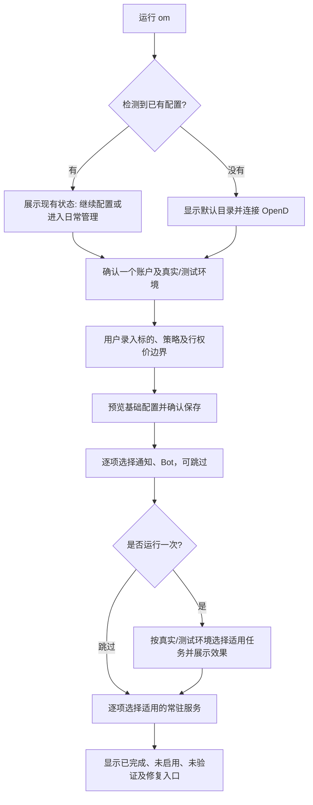
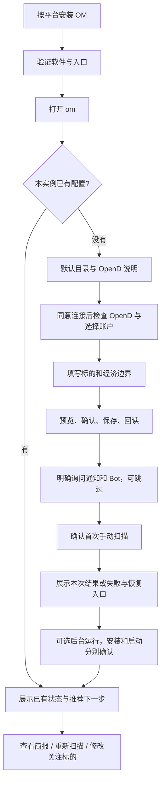

# OM 人工 CLI 产品方案与重构 PRD

状态：已确认的人工 CLI 产品契约。当前操作入口见 README / Getting Started；实现和目标环境验证分别提供证据。

第 11 节是 2026-11-01 根据安装与首次使用检查补充的详细设计提案，尚未实施；其中安装包形式、交互调整和新增验收目标尚待产品确认，不将提案视为已发布能力。第 1–10 节既有有效规则继续保留。

本文记录首次安装、日常管理和命令归属的产品要求；不承载某次任务的交付或生产授权。

## 1. 目标与设计方法

让普通用户从首次安装走到一次结果可解释的运行，并能在日常管理中完成调整、排查与恢复。成功标准是用户完成任务、看懂结果及下一步；顶层命令数量不作为验收指标。

设计顺序：**用户场景 → 具体任务 → 最小必要能力 → 复用现有能力 → 交互与命令归属 → 验收**。

只设两大用户场景：首次安装、日常管理。故障排查、高级维护属于日常管理中的任务。菜单按场景组织；直接命令按账户、标的、Bot、通道等稳定职责组织。同一能力可服务多个场景，不因场景不同再造一套配置或执行逻辑。

奥卡姆取舍：

- 每项新增能力必须对应本表中的真实任务；相同语义只保留一个推荐入口。
- 先复用现有配置发布、凭证存储、策略操作和运行查询，不新增通用配置平台、安装进度数据库或另一套执行引擎。
- 保留用户明确需要的高级能力，以及权限、校验、预览、回读和失败恢复。减少默认帮助中的负担，不以隐藏命令冒充完成合并。
- 命令存在只证明入口存在。交互菜单中的“配置”“编辑”“添加”必须能完成该任务；需要外部登录时明确暂停点和返回方式。

## 2. 已确认的产品边界

| 决定 | 当前有效规则 | 确认依据 |
|---|---|---|
| 配置位置 | 使用平台默认目录并显示位置；普通用户不必选择，高级调用可显式指定 | 用户：“这个不需要用户选择吧？”及后续 PRD 共识 |
| 账户 | 首次只完成一个富途账户；日常再加第二个；同市场账户共享标的 | 用户：“安装走完一个账户”“同市场账户共享标的” |
| 账户映射 | 在账户接入步骤明确 OM 账户与富途账户 ID、OpenD 端点、真实/测试环境；不能通过 ID 猜环境 | 用户要求覆盖映射和 OpenD 测试账户 |
| 标的 | 必须由用户输入，不写示例标的；明确 CSP、CC 或 both；CSP 必填 max strike，CC 必填 min strike，另两界可选 | 用户：“不要写入示例标的”“csp 必填 max strike，cc 必填 min strike” |
| 直接命令 | 仅有 `om symbols add NVDA` 不构成有效新增；缺策略或必填边界时拒绝 | 用户明确否定不附加参数的新增 |
| 可选接入 | 通知、Bot LLM、常驻服务逐项询问、允许跳过；跳过显示未启用 | 用户选择“逐项询问、允许跳过” |
| 凭证 | 终端隐藏输入或系统凭据存储；不通过 Agent 对话框或命令参数传入密钥 | 用户要求避免在 Agent 输入框输入 |
| 命名 | 对外统一推荐 `om`；业务用任务命令，结构化网关用 `om tools`，自然语言助手用 `om bot`；`om-agent`、`om agent`、`om assistant` 保留对应旧语义 | CLI 统一任务；既有“收敛到 om bot”只限定助手名称 |
| 帮助与列表 | 保留面向人的 help 和高级命令；不增加等同帮助的全局 ls；领域 list 服务真实查看任务 | 用户要求 human help、保留高级配置 |
| Holdings | 保留 Holdings 配置命令；不再作为账户类型，不回填富途账户数据或账本 | 用户：“增加holdings的配置命令”“退役external_holdings账户相关的代码” |
| Portfolio Exposure | 始终可用；Holdings 默认关闭，关闭时评估富途，开启后纳入其他来源；显示已观测 broker、market、来源与时间，不声称完整覆盖 | 功能配置会话及其实现会话的后续用户确认 |
| Exposure 口径 | 沿用所有未平仓卖出期权均被指派的情景；不改成 PM 的当前持仓分布 | 用户纠正后确认：“是，沿用指派后情景” |
| Close Advice | 默认开启，日常可关闭并重新开启；关闭不应删除历史结果 | 功能配置会话中用户：“默认开启，然后可以在日常管理中关闭” |

这些决定替代旧稿“开启全局持仓风险”“Holdings 是风险功能启用前提”的要求。有效任务名称为“纳入 Holdings 数据”；不新增 Portfolio Exposure 总开关。账户退役及存量切换见 [退役设计](EXTERNAL_HOLDINGS_ACCOUNT_RETIREMENT_DESIGN.md)。

## 4. 从场景到任务

### 4.1 首次安装

以下编排顺序为建议，复用第 2 节已确认的产品边界。

| ID | 用户任务 | 必要能力 | 完成或暂停条件 |
|---|---|---|---|
| F1 | 安装后找到入口 | 安装完成可使用全局 `om`，提供继续首装的提示；识别系统与默认目录 | 命令可用；检测到已有实例则展示已有配置，不静默覆盖 |
| F2 | 连接 OpenD | 展示默认端点，可修改；指导用户完成 OpenD 安装和登录；只读检查连接 | 连接/登录证据独立呈现；不可连接时可继续准备离线配置 |
| F3 | 绑定一个账户 | 选择市场、真实或测试环境、账户标签和富途 ID；可读到列表时辅助选择，否则明确手工输入待验证 | 映射无歧义；仅完成该账户已确认支持的市场；其他市场若需另一账户，留到日常添加；离线映射显示待验证 |
| F4 | 输入监控标的 | 用户输入代码，规范化市场与代码；逐个设置 CSP/CC/both 及必填边界 | 每个所选市场至少有用户录入的有效标的；缺字段返回对应输入项 |
| F5 | 保存基础配置 | 预览账户、市场、共享范围、策略边界和输出位置；确认后构建、回读 | 成功显示保存结果；失败明确哪些已写入、哪些未生效 |
| F6 | 选择通知 | 询问是否启用；配置支持的通道和接收目标，隐藏录入凭证 | 可跳过；配置成功与测试投递分别报告 |
| F7 | 选择 Bot | 询问是否启用；选择模型、录入密钥、检查配置 | 可跳过；配置检查不冒充真实模型调用成功 |
| F8 | 做一次运行并查看结果 | 展示本次范围与可能副作用；用户选择后运行；默认不发送通知、不启动服务；打开对应结果 | 合法无候选、证据不足、执行失败可区分；可以跳过并显示尚未运行 |
| F9 | 选择常驻服务 | 逐项询问；展示该账户环境支持的服务、计划和影响；确认后执行受控服务流程 | 可跳过；服务文件已生成、已安装、实际运行分别报告 |
| F10 | 知道完成到哪一步 | 汇总配置、账户接入、一次运行、通知、Bot、服务状态及下一步 | 不用一个“全部就绪”遮蔽未验证项；能返回缺失步骤 |

首次结束不强制用户开启 Wheel、Combo 或 Holdings；展示这些可选能力的用途与日常入口。Close Advice 的默认开启状态也需可见，但不能把“已配置开启”写成“已成功评估持仓”。

### 4.2 日常管理

建议导航分组只用于菜单，不新增对应顶层命令。

| ID | 菜单任务组 | 用户任务 | 功能归属及完成条件 |
|---|---|---|---|
| D1 | 查看结果 | 看最新简报、运行是否正常、为何没有结果 | daily-brief/status；显示时间、市场和账户范围，无结果不等于零候选 |
| D2 | 账户与标的 | 查看、增加、编辑或移除监控标的 | symbols；策略和边界校验贯穿所有写入口，预览同市场受影响账户 |
| D3 | 账户与标的 | 添加第二账户、修改映射或移除账户 | accounts；列表可选目标，共享现有标的；说明移除对未来运行和历史数据的影响 |
| D4 | 账户与标的 | 增加另一市场 | 使用账户与标的的同一配置能力，录入该市场标的并预览；不重跑首装覆盖旧市场 |
| D5 | 通知与 Bot | 添加/更换/停用通道与接收目标 | channel；区分出站通知与入站 Bot 消息，验证正确目标 |
| D6 | 通知与 Bot | 启用/停用 Bot、更换模型、问答、查看或取消任务 | bot；模型与凭证检查、只读问答和受控操作的效果清晰 |
| D7 | 通知与 Bot | 录入、轮换、删除凭证 | secrets；不打印值；明确受影响消费者及是否需重载，不暗中重启服务 |
| D8 | 策略与持仓分析 | 调整 CSP/CC 与 Combo 的标的参数 | symbols；保留高级参数及来源解释；Combo 启用规则接独立设计结果 |
| D9 | 策略与持仓分析 | 开启/关闭 Wheel、接受策略变更、处理生命周期 | wheel；复用 activation 与 accept-policy，不增加第二套 enabled 开关 |
| D10 | 策略与持仓分析 | 关闭或恢复 Close Advice，查看已有建议 | close-advice 所属领域；默认开启，关闭保留历史并显示明确状态 |
| D11 | 策略与持仓分析 | 查看 Portfolio Exposure，配置是否纳入 Holdings | portfolio assignment-scenario 与目标 holdings configure；沿用指派情景，只标已观测数据范围 |
| D12 | 策略与持仓分析 | 查看期权持仓、审阅成交、处理修复/回放/作废 | option-positions/trade-events/wheel；保留账本权威、预览、幂等和审计 |
| D13 | 策略与持仓分析 | 查看收益表现、现金空间及研究证据 | option-performance/sell-put-cash/research；保留各自数据和计算语义 |
| D14 | 运行与维护 | 手动扫描、运行整轮任务、看平仓建议 | scan/close-advice/run；明确任务的读取、持久化与发送范围，不能笼统叫“运行” |
| D15 | 运行与维护 | 启停常驻运行、检查服务和计划 | service；复用平台受控流程，实际服务操作能力缺口需补齐 |
| D16 | 运行与维护 | 排查无结果、连接失败、配置未生效 | status → 相关 runs/logs/doctor → 具体领域修复；避免让用户顺序执行所有检查 |
| D17 | 运行与维护 | 检查新版、升级或回滚 | update；针对已发布版本，单独预览并确认，不隐含发布 |
| D18 | 运行与维护 | 高级配置、质量核对、证据归档或缓存修复 | 完整帮助保留 config/settings/healthcheck/support/quality/scheduler/multiplier-cache 等入口及副作用说明 |

## 5. 交互方案与行为合同

### 5.1 建议的首次主线



继续配置根据已有配置、凭证是否存在和当前检查证据恢复；不把旧绿色检查当最新连接证据。不新增独立安装进度数据库。已保存基础配置后退出，不删除正确配置，也不要求重新创建一套配置文件。

真实账户路径与测试路径必须分开说明。SIMULATE 体验扫描沿用现有手动 `run tick --experience --no-send` 契约并完整复用现有请求校验：明确演示假设、不读取账户资产、不发送通知、不写正式金融账本、不接入定时体验扫描、不激活或推进 Wheel。普通 SIMULATE 扫描与显式体验模式不可混为一谈。通道或 Bot 可以单独配置，但不能因此允许发送体验扫描结果。真实账户首次验证运行也默认不发送通知、不启动服务；通知测试和服务启用分别确认。

### 5.2 建议的输入、预览与恢复

- 交互菜单收集用户完成该任务所需的参数，显示实际调用效果；熟练用户可直接运行领域命令。非交互环境缺参数直接报错，不悬挂等输入。
- 直接新增标的仍须指定策略和必填边界；不能把裸 `symbols add` 或仅有代码的形式当成默认策略新增。菜单可提问，完整命令不得依赖隐含策略。
- 编辑保留未修改的有效值，校验修改后的完整配置，不要求重填未变字段。开启原来关闭的一侧时须补齐该侧必填边界；关闭一侧时不再要求其生效边界。
- 可唯一确定的市场在菜单中展示并确认；多市场或代码歧义时要求选择。直接命令的参数别名和自动推断规则作为第 9 节建议确认，不默默跨市场写入。
- 变更预览包含新旧值、市场/账户/标的范围、共享影响、生成配置及外部效果。确认后复用已有发布、备份、源版本检查与回读；配置在预览后变化时，旧预览失效。
- 基础配置、系统凭证、通知测试、服务操作分别确认和报告。服务失败不能声称已撤回已经发出的消息；密钥已存储时也不能在取消后笼统说“完全未写入”。
- 首次配置前取消不写入；某阶段完成后退出保留已确认结果。重进只处理未完成或明确要求修改的部分。外部效果不明先核对回执，不默认重发。
- 普通日常变更不要求用户手工补做 YAML 构建或编辑生成 JSON。构建或回读失败时明确未生效/部分失败，并给出已有恢复路径。

日常变更示例：用户选择已有标的 → 修改 CSP 最高行权价 → 看到同市场全部受影响账户及新旧值 → 确认 → 发布并回读 → 查看有效值。若 OpenD 不可用，正确配置保持已保存，连接显示失败；不使用 Holdings 补成账户事实，也不以此回滚用户的正确修改。

### 5.3 帮助和状态

`om` 在 TTY 提供两大场景的交互导航；`om help`、`om --help` 提供简洁任务帮助；`om help all` 按领域列出全部有效命令、专业维护入口及兼容标记。每个领域支持 `--help`。默认帮助中的新手路径只能指向一个推荐入口。

新增只读 `accounts list`；保留 `symbols list`。不新增作为帮助别名的全局 `ls`。领域列表回答“有哪些对象”，help 回答“可以做什么”。

状态基于现有事实分别表达：是否配置、是否选择启用、依赖检查结果、最近执行结果及证据时间。跳过可选能力是正常状态。连接失败、数据过期、配置不一致、合法无候选和没有运行记录不能合并。状态查看不能暗中刷新业务数据、扫描、投递或修复。

## 6. 命令全集的推荐归属

统一入口的调用与输出规则：

- 人工按业务任务调用 `om scan`、`om position-advice evaluate --request-file request.json`；程序使用 `om tools spec`、`om tools run --tool position_advice_evaluate --input-file request.json`。`om bot run --text "评价一下我的持仓"` 是自然语言助手，`om agent` / `om assistant` 兼容 Bot。
- `om tools` 接入完整现有网关，包括 `spec/run/add-account/edit-account/remove-account`；`om-agent` 继续有效，解析、配置与环境选择、权限、预览确认、审计和业务服务共用，不改名工具或 JSON 字段。详细环境选择见 [Tool Reference](TOOL_REFERENCE.md#参数环境与输出兼容)。
- 支持双格式的业务命令使用局部 `--format text|json`。本轮只将持仓建议默认切为人工展示，脚本追加 `--format json` 取得原业务 JSON；网关保留原 JSON envelope。其他命令保留既有格式，不批量改变默认值或将已有 `--format` 改成全局开关。
- 持仓建议先校验命令参数，再加载实例环境；启动配置错误和业务错误均遵循已选格式（默认/text 为人工失败说明，json 为原错误 envelope），退出码为 2。非法格式、缺必填项及未知选项仍由 argparse 拒绝。
- 持仓人工展示合约、数据时间、评估模式、关键指标、结论和原因，区分成功、部分、合法空结果、不可评估和执行失败。历史参考保留原时间，不能成为当前平仓建议；hold 仅表示本策略未触发平仓条件。请求完成为 0、执行/输入失败为 2，部分结果及不可评估须检查业务状态，不以 0 冒充所有持仓可评估。
- help/spec 不连接券商或写业务状态；主动评估只沿用独立请求报告，不写账本、不发通知、不覆盖计划报告。可选插件关闭或缺包的状态明确可见，核心仍可启动。不要求内部每个工具都有新业务命令，不新增插件框架。

本表的命令归属已纳入本轮确认范围；“高级保留”表示完整帮助可发现、默认任务导航按需引导，不代表退役。本轮保留旧入口兼容，不设自动删除日期或版本。

| 当前顶层 | 建议处置 / 推荐入口 | 依据与限制 |
|---|---|---|
| healthcheck | 高级保留 | 就绪检查有独立消费者；不把所有健康检查等同 doctor |
| doctor | 保留 | 人的故障定位入口，给出具体下一步 |
| support | 高级保留 | 收集脱敏支持材料，区别于状态查询 |
| assistant / agent | 人工推荐 bot，旧入口继续兼容 | 保持 Bot 行为、输出及权限，不作为网关别名 |
| bot | 保留并补齐 | 统一模型、问答、控制、任务与审计的人工入口 |
| tools | 统一推荐的结构化网关 | 复用 om-agent 的所有公开子命令与参数，保留原兼容入口 |
| position-advice | 持仓主动评估 | 默认人工展示；--format json 保留原业务 JSON，不新增策略计算 |
| inbound | 建议归 channel，原入口保留兼容 | Feishu 事件/长连接与微信传输归同一职责；服务调用方需迁移 |
| status | 保留 | 汇总已有运行证据及下一步 |
| runs | 保留 | 查询业务运行历史；区别于 bot runs |
| logs | 保留 | 读取诊断日志和运行审计，不引入重命名迁移 |
| research | 高级保留 | 研究证据采集、归档与清理，不等同 support |
| scan | 保留 | 机会扫描与完整 tick 的效果不同 |
| close-advice | 保留 | 运行与启停配置按领域方案衔接，默认开启 |
| notify | 高级保留 | 当前主要为内容 preview；不能冒称完整投递管理 |
| channel | 保留并收拢传输入口 | 通道、接收目标、连接及状态；首装和日常复用 |
| accounts | 保留，新增 list | 查看、选择、增改删账户及映射 |
| config | 高级保留 | 初始化底层能力、校验、构建、解释；symbol 编辑收敛到 symbols |
| settings | 高级保留现有诊断语义 | 环境设置的 inspect/doctor/explain；不扩成通用业务设置中心 |
| secrets | 保留 | 凭证录入、状态、轮换与删除；业务向导复用 |
| version | 高级保留 | 读取源码 VERSION 与远端 tags；与运行实例的 update check 契约不同 |
| scheduler | 高级保留 | 调度状态与 mark 等操作不等同管理 OS 服务 |
| sell-put-cash | 高级保留 | 现金空间查询有独立语义，未证实可无损并到 accounts |
| service | 保留 | 服务生成、检查、运行管理；当前缺失的启停交互需复用平台流程补齐 |
| update | 保留 | 已发布版本检查、验证、应用与回滚 |
| multiplier-cache | 高级保留 | 合约乘数维护，显示写入性质 |
| setup | 保留 | 完整首次引导；check 保留离线检查语义 |
| option-performance | 保留 | 收益报告及证据维护，不混入普通资产分布 |
| portfolio | 保留 assignment-scenario | Portfolio Exposure 沿用指派情景；不新造 PM 当前持仓计算 |
| daily-brief | 保留 | 日常阅读结果的主入口 |
| quality | 高级保留 | 状态、刷新及维护操作有不同效果，不泛化为 doctor |
| symbols | 保留，收拢标的编辑 | 监控集合及标的策略的人工入口 |
| option-positions | 保留 | 期权账本投影和专业工作流 |
| wheel | 保留 | activation、策略接受与生命周期保持既有领域语义 |
| trade-events | 保留 | 审阅、修复、回放和作废各有明确效果 |
| run | 保留，具体任务按需进入菜单 | tick、cron 和摄取等操作，不变成所有功能的统一容器 |

目标新增入口 `om holdings configure` 保留用户已要求的配置能力。它管理是否纳入 Holdings 数据及所需配置，不是 Portfolio Exposure 总开关；准确字段、启用确认和状态展示范围以独立方案为准。本 CLI 任务不另造 holdings CRUD 或第二套持仓账本。

明确的子命令收敛方向：

- `assistant model ...` → `bot model ...`；控制能力、pending、audit 等归 bot 下相应任务。
- `assistant handle` 和 `bot run` 保留不同语义：控制消息与只读问答不能互换；upgrade-worker 保留高级受控执行边界。
- `inbound feishu/feishu-ws` → channel 中的 Feishu 传输入口；具体子命名建议在兼容表中一并确认。
- `config symbol set` → `symbols edit` 的同等能力；须先证明 Combo、策略边界、预览、回读和旧调用方都覆盖，再转发或退役。
- `config init` 保留高级脚本入口，首次安装只推荐 setup；内部复用同一配置能力。

内部 assistant 配置键、模块名、生成文件和外部网关引用属于明确的兼容清单。人工命名统一不代表这些内部名字已迁移，也不要求只为字面一致重命名全部内部实现。

## 7. 高级功能、范围与数据边界

| 功能 | 本方案中的入口和边界 |
|---|---|
| CSP / CC | 用户在标的任务中选择并约束；参数继承来源和实际生效值可查，缺必填边界不写入 |
| Combo | 通过标的策略任务发现；当前代码按标的开关，最终配置规则接独立设计；不擅自新增全局开关 |
| Wheel | 当前按市场与账户 activation 操作；复用一次操作串联发布与回读，策略变化走 accept-policy；不以关开窗口替代接受策略 |
| Close Advice | 默认开启，日常显式关闭/恢复；缺证据不得表示无需平仓，关闭不删除历史结果 |
| Portfolio Exposure | 所有未平仓卖出期权均被指派的情景，沿用现有 portfolio 入口；与当前实际资产分布清楚区分 |
| Holdings | 仅供 Exposure 场景的可选数据源；默认关闭；仅标已观测范围，读取失败/缺失不得显示零持仓或完整覆盖 |

富途账户当前现金、持仓以该账户券商证据为准；本地期权状态以 SQLite 事件账本与投影为准。差异保留并显示。Holdings 不作为账户类型、富途失败回退或期权账本写入来源。

旧 external_holdings 的处置由独立交付负责。CLI 应接入其最终迁移说明，不自行发明第二套迁移命令；不静默删除旧账户、转为富途账户或把旧数据自动并入 Exposure。删除一个监控对象或停用一个功能，不能隐含删除历史账本。

macOS 与 Linux 使用相同任务、术语和结果判定，底层分别复用对应服务与凭证方案。不能用 Linux 模拟通过证明 macOS 实际可用；凭证还必须由实际服务运行身份读得到。

## 8. 验收计划

本节为目标验收标准，已纳入 2026-10-04 确认的实施范围。源码验证与真实环境验收分开记录；后者须在授权的目标环境进行。具体实现与测试证据以交付 PR 为准。

| ID | 输入与场景 | 可观察通过条件 | 证明方法、环境与边界 |
|---|---|---|---|
| A1 | 无配置的首次用户从 om 进入安装 | 默认目录可见且无需选择；一账户、用户标的和边界可完成保存；每个配置菜单真正执行对应流程 | 扩展现有 tests/test_cli_home.py 与 tests/test_setup_init_cli.py，临时目录+TTY输入驱动；不证明外部接入 |
| A2 | 新增缺策略/必填边界；编辑开启新策略但缺边界、上下限倒置；只修改一个有效字段 | 新增和编辑后的无效配置在所有写入口一致拒绝，文件与快照不变；合法编辑保留未变字段；无示例标的 | 覆盖 setup、symbols 与旧 config symbol facade；复用 tests/test_cli_symbols_authoring.py、tests/test_symbol_mutations.py 的隔离契约 |
| A3 | REAL、SIMULATE、ID与环境不匹配、OpenD不可达 | 映射和缺口可见；不换账户；体验扫描严格维持手动/no-send等边界 | CLI场景测试+隔离OpenD元数据；真实连接另需用户授权的OpenD环境，模拟不证明登录成功 |
| A4 | 基础配置后退出、存量重进、确认前取消、过期预览、写入失败 | 按阶段保留已确认结果；取消不多写；不覆盖新配置；回读和恢复提示反映实际状态 | 扩展现有首装与配置发布故障注入测试，在临时目录验证源文件、生成快照与记录；不新建状态数据库 |
| A5 | 首次跳过通知/Bot/服务，日常再启用；配置通过但外部失败 | 未启用、已配置未验证、验证失败分别呈现；不可误报就绪 | 菜单和检查输出断言；模型调用/投递/服务实测分别安排，经授权后记录结果与时间 |
| A6 | 添加同市场第二账户，再改共享标的 | accounts list 可查映射；复用共享标的，预览列出全部受影响账户；移除不删账本 | 账户/标的 facade 与临时生成配置回读，参照 tests/test_account_scope_authority.py |
| A7 | 密钥录入、轮换、取消及服务消费 | 参数、预览、日志、错误和对话不含明文；区分已保存与未保存；服务身份可读取 | 复用 secret_ops 的隐藏输入测试；macOS/Linux本地存储与服务身份实测需要对应环境和授权 |
| A8 | 旧 assistant/inbound/config symbol 调用与新入口 | 同输入保持业务效果、权限、输出和失败语义；帮助只推荐新人工入口 | 子命令兼容对照；服务模板/网关调用方清点，副作用用隔离适配器，关键集成单独验收 |
| A9 | Holdings关闭、配置完成、读取失败；只见部分broker/market | Exposure 始终可进入且保持指派口径；不把可选数据源当总开关；只展示有证据的范围 | 与独立方案的配置/状态验收集成；外部表读取实测须授权，不能靠配置存在证明完整数据 |
| A10 | Wheel启停、策略变化；Close Advice关闭/恢复；Combo参数 | Wheel不出现第二套开关；Close Advice状态准确且历史保留；Combo遵守最终确认的范围 | 复用各领域测试，增加菜单到现有操作的集成验证；独立功能交付未完成部分标依赖 |
| A11 | 无结果、无候选、失败运行；查看结果后手动运行/升级 | 状态和证据时间可辨；查看无隐含执行；执行前范围与副作用明确；不自动发布或重发 | 运行/诊断入口隔离测试；真实服务/升级验收需指定环境、目标和授权 |
| A12 | 两个平台首次与日常帮助、README及完整命令表 | 两大场景能找到全部承诺任务；高级能力可发现，文档只写已实现命令，34项无失联 | CLI帮助快照、表单人工走查、文档链接/命令核验；macOS和Linux各自做目标环境验收 |

后续实现者负责离线与集成验证，环境操作者负责授权外部验收。缺真实凭证、OpenD或服务环境时，交付应列出未验证项，不能以模拟测试替代。

## 9. 取舍、依赖与交接状态

本轮建议优先顺序：先补“完整首装”和“可完成的日常账户/标的变更”，随后完成 Bot 与通道归属收敛、接入独立功能配置。高级命令优先保持现有行为；未证实重复的入口不做纯命名搬迁。

反例复核及裁决：

- 固定六个命令无法自然容纳账本、策略与运维；取消数量目标，保留稳定职责。
- 首装把所有外部效果装入一次确认，会使失败恢复无法解释；采用阶段性确认与各自回读。
- 只改 help 不能让用户配置通知、模型或第二账户；验收必须从菜单走完操作。
- Holdings 总开关会阻断只有富途的用户；替换为可选数据源配置，沿用已有指派情景。
- 显式体验模式不能接入定时扫描；普通 SIMULATE 工作流是否支持常驻，按其现有契约核实，不从体验模式推导。
- 将 config symbol set 直接删除会丢失字段/调用方；先做能力与确认契约对照。

实施时已收敛的产品/集成事项：

1. 用户已确认完整向导与恢复、日常管理任务、第 6 节命令归属，按可完成的用户任务验收。
2. assistant/inbound 按子命令复用原 handler，保留兼容；人工推荐入口改为 bot 与 channel。内部配置键和网关契约保留。
3. 2026-10-04 已核对主线：external_holdings 已退役；Holdings 使用现有 PM non_futu 包含开关及来源清单核验，不保存券商批准集合；保留 source/preview 双摘要和预检。Close Advice 使用现有 enabled 默认 true；Combo 保留既有标的参数，不发明新规则。
4. macOS/Linux 复用现有 renderer/profile，补齐基本安装、启停和状态回读；账户 facade 明确 REAL/SIMULATE。真实平台、OpenD、凭证和投递验收仍需对应环境授权，隔离测试不替代外部事实。

## 10. 实现入口与验证边界

核对当前实现从以下 owner 及相关测试进入：

- [CLI首页](../src/interfaces/cli/home.py)、[解析与路由](../src/interfaces/cli/main.py)、[首装入口](../src/interfaces/cli/setup_ops.py) → [配置生成与发布](../src/application/config_yaml_init.py) → source/runtime/root record 的写入、验证和失败清理 → 用户结果；对应 [首装测试](../tests/test_setup_init_cli.py)、[首页测试](../tests/test_cli_home.py)。
- [账户入口](../src/interfaces/cli/account_ops.py)、[标的入口](../src/interfaces/cli/symbols.py)、[旧配置入口](../src/interfaces/cli/config_ops.py) → [标的修改与发布](../src/application/config_yaml_symbols.py)；验证策略必填字段、共享市场范围及已有发布调用。
- [凭证入口](../src/interfaces/cli/secret_ops.py) → 系统存储 provisioner；确认隐藏输入、TTY要求和取消/删除边界。[settings](../src/interfaces/cli/settings_ops.py) 仅作环境来源诊断。
- [Bot](../src/interfaces/cli/bot_ops.py)、[assistant](../src/interfaces/cli/bot_ops.py)、[inbound](../src/interfaces/cli/inbound_ops.py)、[channel](../src/interfaces/cli/channel_ops.py) 的解析和路由；确认读问答、控制和传输不可混为同一语义。
- [portfolio](../src/interfaces/cli/portfolio_ops.py) 保留 assignment-scenario；[运行入口](../src/interfaces/cli/run_ops.py) → [体验模式门禁](../src/application/experience_mode.py)；核对 SIMULATE、手动与 no-send。
- [操作入口](../src/interfaces/cli/operator_ops.py)、[服务入口](../src/interfaces/cli/service_ops.py) ；[version](../src/application/version_check.py) 与 [upgrade check](../src/application/service_upgrade.py) 的版本来源和运行实例处理不同。

隔离配置、菜单、服务与回执测试用于核验源码行为。真实扫描、通知、模型调用、账户读取和服务状态须在对应环境分别验收；命令归属表中的高级保留是兼容选择，不证明所有业务领域均已验证。

外部参考只支持交互机制，不决定 OM 的业务边界：[Command Line Interface Guidelines](https://clig.dev/#help) 支持帮助发现、明确反馈、TTY交互与可脚本化操作；[GitHub CLI 完整命令参考](https://cli.github.com/manual/gh_help_reference) 展示核心与附加命令分组。本文据此建议渐进展示，未把“少量推荐入口”等同于删除高级能力。

当前 CLI 的行为证据归公开入口及其测试，生产效果归实际运行回读。产品目标与实现不一致时保留差异，不通过修改需求掩盖。

## 11. 简单安装与首次使用详细设计

2026-11-01 用户授权按 Gateflow 实施 W1–W5 并做独立 QA，本节作为已确认的目标与验收依据。下文的差距是实施前检查结果；当前操作以 INSTALL、Getting Started 和 Release Process 为准。源码实现、自动化验证、真实平台与用户验收、正式发布分别记录，不能相互替代。

### 11.1 目标、范围与完成定义

用户目标：能简单地安装 OM，完成自己账户的一次扫描，知道结果如何理解，以及下次如何使用。

本提案面向 macOS 普通个人用户和 Linux 自部署用户；继续沿用人工 CLI。首要目标为 macOS，Linux 按已验证的平台逐步提供同一能力。Windows、完整 GUI、Docker 产品化和 OpenD 打包不在本提案实施范围内。Docker 可作为后续分发方式评估，不能替代本节的首次使用验收。

| 层次 | 完成条件 | 不足时怎样呈现 |
|---|---|---|
| 软件安装 | 支持的系统上不要求用户安装 Python、Git、Homebrew、uv 或编译工具；版本与命令入口通过本地自检 | 明确失败步骤和重试入口；不展示“安装完成” |
| 基础配置 | 一个市场、一个用户选择的账户、用户输入的标的及经济边界，经预览、确认、发布和回读 | 已保存但待连接验证；不声称可扫描 |
| 首次运行 | 用户同意扫描后，可定位本次 run 的终态与对应结果；合法无候选也算完成 | 部分数据、扫描失败、用户跳过分别显示 |
| 理解结果 | 能辨认账户、市场、数据时间、候选／无候选／证据不足，知道报告是已有结果还是新扫描 | 阅读说明紧邻结果，不能要求先学内部字段 |
| 日常使用 | 再次打开同一实例，能独立查看结果、重新扫描、修改标的和策略边界 | 给出本实例的具体修复或继续入口 |

安装、配置、扫描、通知送达和后台运行分别判断，不合并成一个“全部就绪”。本节不以必须出现候选作为成功条件。

### 11.2 实施前差距与约束

以下为 2026-11-01 工作区源码检查结论，不代表某个已发布版本或运行实例的实际状态。

| 当前边界 | 证据 | 提案处理 |
|---|---|---|
| 安装器要求系统 Git、Python，在用户机器创建 venv 并安装依赖 | `scripts/install.sh`、`scripts/python_runtime.sh` | 提供预构建的完整运行包；源码安装保留为高级路径 |
| 安装后默认推荐 setup check，与 README 的 setup init 不一致 | `scripts/install.sh` 的 print_next_steps | 首次安装只突出进入向导；已配置实例突出打开日常入口 |
| 用户必须手工寻找数字账户 ID；网关已有单账户元数据校验 | `src/interfaces/cli/setup_ops.py`、`src/infrastructure/futu_gateway.py` 的 FutuGateway.get_account_metadata | 扩展现有网关读取账户候选，人工选择后使用同一校验 |
| 首次输入出错抛出错误，没有字段级重试 | `src/interfaces/cli/setup_ops.py` 的 run_setup_init | 交互层保留会话草稿并重输错误字段；底层验证不放宽 |
| 日常菜单查看简报不传市场，查询默认尝试加载 US、HK 两份配置 | `src/interfaces/cli/journeys.py`、`src/application/agent_tools/daily_brief.py` | 在共享查询 owner 按有效配置选范围，菜单复用 |
| 首次扫描后没有展示本次简报；子步骤失败后仍可返回向导退出码 0 | `src/interfaces/cli/journeys.py` 的 first_install | 返回明确完成摘要，并绑定本次 run 读取结果 |
| 离线检查无条件检查 Bot 模型与会话目录 | `src/application/setup/check.py` | 基础检查与已启用可选功能检查分开，未启用不作为提醒 |

保留原有账户标签无个人默认值、同市场共享标的、YAML authoring、生成 JSON、秘密存储、预览确认和失败回读规则。新增内容复用这些 owner，不建立安装进度数据库、另一套配置引擎或策略计算。

### 11.3 推荐用户路径



继续保留“通知、Bot、服务逐项询问、允许跳过”的已确认规则。通知与 Bot 的询问仍在首次扫描前，服务仍在首次扫描后；每个问题简短说明用途和“首次扫描不需要”。暂不通过重排这些步骤改变既有产品决定。

### 11.4 软件安装与分发

**推荐形式：完整运行包加现有安装器。** 用户仍从官方 README 复制一条安装命令；安装器自动选系统和架构、下载已发布运行包、验证并安装，再提供一条可直接复制的打开命令。运行包内含完整 CPython、固定的已验证依赖和 OM 程序，不在用户机器执行 pip install。

| 选择 | 对本目标的取舍 |
|---|---|
| 维持系统 Python/Git 安装 | 发布维护最少，但新用户仍需处理系统依赖，不满足免准备依赖的目标 |
| 安装器自动获取 Python 并现场安装依赖 | 用户无需手装 Python，可作较小技术试验；仍有多个下载来源、现场依赖解析与安装失败，需要另行验证恢复 |
| 完整运行包（推荐） | 把依赖准备前移到构建验证；代价是下载与磁盘占用、平台构建矩阵以及随发布维护解释器和依赖安全更新 |
| Docker | 对已有 Docker 用户有价值；普通桌面用户仍需额外准备运行环境，且不能消除 OpenD 登录、网络和首次使用问题 |

本提案仍需要用户打开终端、复制安装命令并再次打开 OM；它不是双击即用的桌面应用。若目标改为完全不接触终端，需另行确定原生安装包与启动器的产品范围，不能把本方案验收当成已经达成该目标。

选择完整解释器的原因是 OM 当前复用 `sys.executable` 启动 Python 子进程；将程序冻结为单个可执行文件需要重新验证这些调用。候选解释器来源为 python-build-standalone 的固定 CPython 3.12 发行包，保留上游来源、摘要和许可；不是安装时追随上游 latest。官方提供按平台的完整 Python 分发，但 OM 的依赖、搬迁和平台兼容仍需单独验证：[上游运行说明](https://gregoryszorc.com/docs/python-build-standalone/main/running.html)。

| 项目 | 设计 |
|---|---|
| 资产名 | 拟定 `options-monitor-<tag>-<os>-<arch>.tar.gz`；与既有源码 archive 分开，不改变源码 archive 的含义 |
| 首批目标 | macOS arm64、macOS x86_64；Linux glibc x86_64 随对应环境验收提供。Linux arm64、musl 不默认宣称支持 |
| 系统范围 | 构建清单记录并验证最低系统版本、CPU 和库要求；只有通过的目标列入支持表，实施前不凭解释器可用推断 OM 可用 |
| 包内容 | OM 发布源码中的运行必需文件、`runtime/` 私有解释器及依赖、版本与构建清单、第三方许可；不含用户配置、报告、密钥和账本 |
| 依赖 | 在构建端按现有 runtime/server requirements 和 constraints 解析并测试，记录全部实际版本；运行包包含当前公开可选通道所需依赖，关闭功能不要求凭证 |
| 发布清单 | 同一次发布记录 tag、commit、平台、CPython 来源与版本、全部依赖版本、资产 SHA-256；发布前做元数据、归档与实际解包执行一致性检查 |
| 安装所需工具 | shell、HTTPS 下载、tar 和平台自带摘要工具；先检查并汇总缺失项。不要求系统 Python/Git，不修改系统解释器 |
| 目录 | 保留 `<prefix>/releases/<version>`、`current` 和用户级 om/om-agent wrapper；运行目录仍独立 |
| 默认版本 | 只消费已发布稳定版本；缺少对应运行包就明确告知不支持该目标，不自动切源码安装或要求安装编译器 |

安装顺序：先检查系统、架构、目标路径与 wrapper 归属 → 解析确定 release → 下载并校验对应资产 → 在本次独占 staging 解包 → 自检 → 发布到 release 目录并更新 wrapper/current → 回读有效版本与入口。沿用现有事务的备份、失败恢复、已有目标拒绝和活动版本保护，不另建一套覆盖协议。

自检须覆盖解释器、核心依赖导入、CLI help、Tool Gateway spec 和 Python 子进程；不连接 OpenD、调用模型、创建用户配置、写账本、发消息或启动服务。测试只能写 staging 中隔离的必要自检产物。

解释器选择在 `scripts/python_runtime.sh` 扩展：保留显式 `OM_PYTHON`，增加包内 `runtime/` 选择，再沿用现有 `.venv` 与系统候选。包声明自带解释器却缺失或失效时明确失败，不偷用系统 Python。生产 service 采用同一选择规则，不要求用户设置环境变量。

搬迁验证使用实际发布包而不是复制开发 venv；原始构建路径移除后，在含中文和空格的新路径运行所有入口与子进程。程序统一通过 `python -m` 或已有 shell facade 启动，不依赖构建环境中的 pip console-script 绝对 shebang。

安装成功输出示意：

```text
OM <version> 已安装，程序检查通过。
下一步：运行下方命令，确认你的富途账户并完成第一次扫描。
  "<实际 bin-dir>/om"
软件安装不会自动连接券商或启动后台任务。
```

实际命令按用户目录正确引用；不要求先修 PATH。PATH 配置放在可选说明。安装结束不自动启动交互向导，避免 curl 管道 stdin、非交互安装和隐含业务操作问题。

**升级是运行包的一部分。** `src/application/service_upgrade.py` 中仍有 Git 镜像、源码物化和 venv 准备路径；对运行包安装须增加同一升级流程下的资产物化分支，更新检查不能因本机无 Git 而失败。通过已安装构建清单识别来源，bundle → bundle、source → 原流程，不隐含转换安装类型。已有 preview、目标校验、服务协调、回读与恢复继续生效。第一次安装不接管活动生产服务；检测到受管活动实例时，引导到受控升级。回滚需验证数据格式兼容，不把切换 current 等同于账本可回滚。

发布脚本与文档的变更属于后续实现；本提案不执行打包依赖安装、发布或升级。没有完成安装与升级的一致验证前，不将运行包作为默认稳定安装路径。

### 11.5 首次配置交互

**入口和实例。** 无配置时突出“开始首次配置”，显示平台默认目录及该目录用途；用户无需填写路径。有配置时展示账户和市场，选择继续未完成步骤或日常管理，不覆盖已有文件。显式路径、OM_RUNTIME_ROOT 与已有目录记录冲突时沿用现有校验，不自动换实例。

**OpenD。** 先解释“这是富途登录与数据连接程序，需你在官方程序中安装并登录”。展示官方入口、本机默认端点和“使用其他地址”选项。用户选择“检查连接并选择账户”后才查询；缺 OpenD 或未登录时给出具体原因，可重试、改端点或继续离线填写。只检查用户指定端点，不扫描端口、不代登录、不改 OpenD 配置。

**账户辅助选择。** 当前 `FutuGateway.get_account_metadata` 依赖已知 ID；在该 gateway 扩展有界的账户候选读取，复用其 SDK context、错误映射、ID/环境规范化和市场权限解释。应用接入边界负责调用与选择；CLI 不直接访问 SDK。只读账户元数据，不查询资金、持仓或解锁交易。完整 ID 仅在进程内用于选择和确认写入配置，不输出到普通日志、支持包或菜单；账户标签仍由用户填写，无 lx 等个人默认值。

用户先明确市场、真实／模拟环境；候选按环境和已证实的市场权限显示脱敏尾号及账户类别。单个候选也需要确认；多个必须选择；尾号相同用会话序号和已返回类型区分，仍不明确时要求用户核对。字段缺失不推断权限。列表为空、无匹配项、未登录、连接失败分别提示，不能合成“没有账户”。候选只属当前端点及本次查询，不持久化为券商事实缓存。手工填写路径继续可用，标记待验证；保存成功不改变该状态。

**标的与价格。** 用户输入自己的股票；沿用现有代码规范化，不写示例标的。交互选择显示中文完整名称及 CSP/CC 缩写，逐个询问必填边界；可选另一界放入“是否进一步限制行权价区间”。不询问技术筛选默认值。

```text
该股票希望查看哪类候选？
  1  现金担保卖出认沽 CSP
  2  备兑卖出看涨 CC
  3  两类都看
CSP：你愿意接货的最高行权价是多少？（按当前市场币种）
CC：你愿意卖出股票的最低行权价是多少？（按当前市场币种）
```

这些是合约筛选边界，不是最大亏损、资金保证或股票覆盖证明。只持有股票不替用户自动启用 CC，只有现金也不自动启用 CSP。必填、正数、上下界关系由同一 authoring owner 验证，CLI 原地处理错误，不另写一套策略规则。

**输入恢复。** 首装、日常账户和标的表单共用必要的字段询问 helper；选择错误显示合法选项，数字错误指出单位和字段，跨字段错误回到对应项目。草稿只存会话内存，尚未确认不落盘。EOF/Ctrl-C 明确报告哪些阶段已保存；当前未确认草稿退出后需重填，不承诺跨进程恢复全部未保存输入。直接命令与脚本缺参仍立即失败，不进入等待。

**预览。** 默认突出账户标签、脱敏账户 ID、市场、环境、OpenD 端点、标的、中文策略边界及币种，最后列出保存位置。完整路径与内部键可在详情查看；写入前仍展示必要范围。只创建已经配置的市场，不要求补另一市场。确认后沿用 source/runtime/root record 的同一事务与回读。

### 11.6 首次扫描与结果阅读

通知和 Bot 可逐项跳过，未启用是正常状态。真实账户不询问“是否使用 SIMULATE 体验模式”；仅当所选配置全部满足现有体验门禁时展示该选项。普通 SIMULATE 扫描和显式体验仍分别解释，最终门禁由 `src/application/experience_mode.py` 判定，不靠菜单隐藏代替校验。

连接验证失败时先提供重试、修改连接信息、保存退出或继续离线配置。没有有效连接证据时，不把“开始扫描”作为推荐下一步；用户明确选择重试扫描仍须重新确认范围并经过现有校验，不把旧连接检查当永久许可。不因一次 doctor 的闭市／行情缺口阻止所有离线管理。

扫描前显示账户、市场、标的数量、连接端点及本次效果：读取外部数据，保存本地结果、缓存和状态，本次不发送通知、不启动服务。沿用现有手动 `run tick --no-send --force`；force 仅跳过计划时段，不跳过策略、身份和数据资格检查。已有通知、Bot、服务启用状态不因本次手动选择而被关闭。

**本次结果归属。** 在 `src/application/multi_account_tick.py` 的同一应用入口提供可取得本次执行引用的内部调用形态；保留 `run_tick(argv) -> int`、现有 CLI 和定时调用兼容。引用最少含退出码、是否创建 run、本次 run_id 和绑定实例；账户/市场取本次已确认配置。不能只在调用后读取模块全局 current_run_id，也不能通过目录最新修改时间猜本次运行。入口校验失败尚无 run 时明确表示没有创建本次运行。

简报读取在 `src/application/daily_decision_brief_repository.py` 增加本次 run 的受校验读取能力，复用已有 run 下 `daily_decision_brief.<MARKET>.json` 导出、历史 revision 及 digest 验证。调用者不得自行解析拼接 JSON 绕过 repository。历史记录或导出已清理、缺失、损坏、身份不符时显示来源不可用，不回退其他 run 冒充本次。读取既有结果不触发新扫描或持久化修复。

扫描结束必须展示本次终态；存在可靠结果时用现有 Daily Brief renderer 呈现，并在相邻说明中解释最多手数共享现金、年化非承诺、估算非成交。保持现有策略输出与风险口径，不设计另一份首装候选评分。

| 本次证据 | 用户可见结果 | 默认下一步 |
|---|---|---|
| 有通过条件的候选 | 本次完成、账户/市场/数据时间及简报；明确需自行复核 | 查看详情或回日常菜单 |
| 扫描完整且零候选 | 本次完成，当前条件下暂无候选 | 稍后扫描；不建议为得到候选放宽条件 |
| 部分数据不可用 | 显示已覆盖范围和缺口；不能把相关零候选当完整结论 | 查看缺口及对应重试入口 |
| 失败或不可评估 | 本次失败／不可评估、原因和已完成部分 | 修复后重试，或保存退出 |
| 已有旧成功简报但本次失败 | 优先显示本次失败；旧简报独立标注时间并由用户选择查看 | 不将旧结果作为本次成功 |
| 未执行或取消 | 配置已保存，首次扫描尚未完成 | 下次打开继续 |
| 显式模拟体验 | 使用现有体验结果与假设说明，不能声称真实账户容量 | 仅查看体验结果；不启用定时体验 |

输入标签与阶段名是展示投影，不新增业务状态枚举或持久工作流。结果时间使用实际数据与接收证据；不得给历史结果添加“刚刚更新”。

### 11.7 首页、查询范围与日常使用

首页首先显示绑定实例的账户/市场、最近一次尝试及最近可读结果时间。使用本地配置、现有 run/repository 证据和可用服务回读；不调用模型、不查券商、不修配置，不为首页执行全套健康检查。服务状态证据不足显示“未知”，不能根据 profile 存在推断自动运行已开启。

普通首页推荐以下任务；未配置时突出首次配置，尚未扫描时突出继续首次扫描，失败时突出问题与修复。高级任务仍在现有日常管理及完整帮助中，不删除专业入口。

```text
OM · <用户账户> · <已配置市场>
最近扫描：<本次尝试状态与时间>
可读结果：<结果时间；若较旧明确标示>
自动运行：<已确认状态；未知则显示未知>

1 查看决策简报（读取已有结果）
2 重新扫描（连接富途，另行确认）
3 修改关注标的与策略边界
4 其他管理与可选功能
0 退出
```

查询范围由 `src/application/agent_tools/daily_brief.py` 的共享 owner 决定：显式市场只读该市场；未指定市场先按当前实例的有效 authoring 市场选择，再加载所需生成配置。无 authoring 的兼容实例仅发现已有合法 runtime 文件。未配置市场不要求创建文件；已配置市场缺文件、损坏、陈旧或身份冲突必须保留错误，不以“只查存在文件”掩盖。多市场默认汇总及历史查询的账户/日期约束保留；菜单可明确选一个市场。CLI、Tool Gateway 与其他消费者同用该规则。

首次结束给出短摘要：软件已安装、配置是否保存、账户连接是否验证、本次扫描终态、可读结果时间、自动运行状态，以及“下次运行实际 om 入口”。通知/Bot 未启用仅占一行普通说明；Wheel、Combo、Holdings 不在结束时集中讲解。

### 11.8 错误、恢复与完成语义

| 错误/暂停 | 展示和恢复 | 必须保留的证据 |
|---|---|---|
| 下载失败、摘要不符、平台不支持 | 说明具体阶段；重试确定版本或查看支持表 | 当前版本和已有 wrapper 不被破坏，不降级为源码安装 |
| 已有配置或实例冲突 | 显示已有目标并进入继续/日常管理；冲突先核对 | 不覆盖、重建或删除用户文件 |
| 输入无效 | 原字段重输，保留其他会话输入 | 未确认草稿不写入 |
| OpenD 未启动、未登录或认证待处理 | 指向官方程序处理后主动重试 | 不自动启动或重置认证、不换端点/账户 |
| 没有匹配账户或权限证据不全 | 明确环境与市场缺口，可重新选择或手工填写待验证 | 不靠账号尾号或可连接端口推断就绪 |
| 保存中断、构建或回读失败 | 显示实际已写部分、未生效部分和现有恢复入口 | 不声称全部撤销；不自动删除归属未知文件 |
| 扫描失败、取消、超时 | 优先说明本次运行情况，保留配置和已有结果 | 重试新扫描要再次选择，不自动重复外部调用 |
| 通知/Bot/服务失败 | 只把该可选步骤标记失败，展示修复入口 | 不抹掉基础配置或已成功扫描；消息结果不明先回读 |

交互首页是导航容器，正常返回菜单不等于子任务成功；每个子任务保留自身返回结果。直接执行 `om setup init` 时：未执行/跳过业务步骤可返回 0，但明确未完成；主动执行的连接/扫描/配置步骤尚有未解决失败时返回非零；用户修复并重试成功后可清除本会话对应失败。取消且无失败按原有取消语义处理；不把它打印为任务完成。非交互 `--dry-run`/`--apply` 的现有输出与退出语义保持。

不要为这套展示新建完成标志文件或安装进度数据库。跨会话从实际配置、生成身份、已有运行及服务证据恢复；旧成功不掩盖新的失败，旧连接成功不冒充当前在线。

### 11.9 实现责任与必要改动

下表为拟改动位置，非已实现 API；新增函数、字段仅在对应边界确有调用需要时引入。

| 责任 | 现有 owner | 改动与受影响消费者 |
|---|---|---|
| 运行包安装与解释器选择 | `scripts/install.sh`、`scripts/python_runtime.sh`、`om`、`om-agent` | 安装资产分支、包内 Python、原子发布和失败恢复；两入口、子进程及 service 共用 |
| 运行包构建、发布资格与升级 | `.github/workflows/_release-reusable.yml`、`scripts/release_check.py`、`src/application/service_upgrade.py` | 增加平台资产构建/校验与 bundle 升级分支；保留现有发布和生产边界 |
| 首页与交互编排 | `src/interfaces/cli/home.py`、`src/interfaces/cli/journeys.py`、`src/interfaces/cli/setup_ops.py` | 状态入口、字段重试、逐项可选、终态及修复选择；保留直接命令兼容 |
| 账户候选与校验 | `src/infrastructure/futu_gateway.py`、`src/application/futu_doctor.py` | 复用同一网关查询/错误/规范化，在现有应用接入边界增加有界候选选择；最终配置复验 |
| 配置发布 | `src/application/config_yaml_init.py`、`src/application/config_yaml_symbols.py` | 继续负责完整校验、发布及回读；向导不直接修改生成 JSON |
| 离线诊断 | `src/application/setup/check.py`、`src/interfaces/cli/home.py` | 关闭可选功能不产生无关提醒；保留明确启用但缺凭据/配置的错误 |
| 本次执行引用 | `src/application/multi_account_tick.py`、`src/interfaces/cli/run_ops.py` | 同一执行入口返回绑定 run 的内部引用，旧 int facade 和调度调用保留 |
| 简报读取与范围 | `src/application/daily_decision_brief_repository.py`、`src/application/agent_tools/daily_brief.py`、`src/interfaces/cli/daily_brief_ops.py` | 本次 run 读取、配置市场发现及共享验证；当前、历史、通知 preview 和 Tool Gateway 回归 |
| 运行事实与正文 | `src/application/agent_tools/runtime_status_impl.py`、`src/application/daily_decision_brief_renderer.py` | 复用已有运行选择、质量与正文；只增加必要的人可读投影，不另起计算 |

文档维护：本文件持有用户旅程与验收；安装操作由 INSTALL、README 持有；运行包发布/升级合同由 RELEASE_PROCESS 持有；新增共享查询能力登记 API_INDEX；实际命令/平台通过验证后再修改公开操作说明。不提前把本提案写成现成操作指南。

### 11.10 验收矩阵

| ID | 场景 | 可观察通过条件 | 验证位置/方式 |
|---|---|---|---|
| U1 | 无 Git/Python/Homebrew 的支持系统 | 运行包安装、help/spec/子进程通过，不尝试系统依赖安装或联网业务调用 | 扩展 `tests/test_install_script.py`、`tests/test_python_runtime_contract.py`；各平台干净环境实际运行包验收 |
| U2 | 下载中断、校验失败、入口发布失败、活动版本重装 | 原版本和入口保持可用；失败阶段准确，重试遵守已有目标规则 | installer 现有故障注入及发布包路径回归 |
| U3 | 解包搬迁到中文、空格路径，原构建路径已移除 | CLI、模块子进程、核心依赖及可选依赖导入成功，无原绝对路径依赖 | 真实平台 bundle 自检；不能用仅 mock 文件证明 |
| U4 | 无配置首次进入；已有配置重进 | 一条主线可完成；默认目录无需选择，已有账户/标的不被覆盖 | `tests/test_cli_home.py`、`tests/test_cli_journeys.py`、`tests/test_setup_init_cli.py` |
| U5 | 单个/多个账户、同尾号、无权限字段、环境不符、连接失败 | 显式选择与待验证语义正确，无账户资产查询；不猜测映射 | 扩展 `tests/test_futu_gateway_minimal.py`、`tests/test_futu_doctor.py` 与 journey 集成 |
| U6 | 填错市场/端口/策略/价格、跨字段错误、EOF/Ctrl-C | 有效输入保留，错误字段重输；未确认不写入，已保存阶段保留 | 交互 facade 输入驱动，校验源文件/快照及副作用 |
| U7 | 只配置 US、只配置 HK、多市场中已配置一份损坏 | 单市场简报可读；损坏的已配置市场报错而非被跳过；所有消费者范围一致 | `tests/test_daily_decision_brief_agent_tool.py`、`tests/test_daily_decision_brief_cli.py`、`tests/test_cli_journeys.py` |
| U8 | 本次成功、有旧成功但本次失败、两个运行交错、本次未创建 run | 展示仅绑定本次引用；旧结果独立标注；不通过 latest/global 猜测 | 扩展 repository 与首次运行 facade 集成；并发/交错以受控 fixture 证明实际归属 |
| U9 | 零候选、部分数据、闭市、来源缺失/损坏/清理 | 终态、时间和缺口正确，不伪造零候选或本次成功 | 复用 Daily Brief scenarios/renderer/repository 测试，加入口级断言 |
| U10 | 跳过/启用通知、Bot；真实/模拟账户 | 未启用无无关提醒；启用缺配置仍报错；REAL 不出现体验选项，绕菜单仍受原门禁保护 | `tests/test_setup_check.py`、journeys 和现有体验门禁回归 |
| U11 | 原 CLI、Tool Gateway、定时 service、升级/回滚 | 直接调用契约保留；bundle 不依赖本机 Git/venv，service 使用有效解释器；数据不被包覆盖 | 既有相关 facade、service/release 测试及平台受控验收 |
| U12 | 新用户仅看公开指引，完成首次和第二次使用 | 可独立完成安装、确认账户、理解结果、重新扫描与修改一个标的边界 | 真实用户走查；记录步骤、耗时、求助点，外部操作须授权 |

文档阶段只做事实、引用、格式及仓库 guardrails，不运行真实扫描、模型、通知、服务或升级。实现阶段按变更运行相关测试，交付保留完整自动发现和必需 CI，不以筛掉失败或慢测试换取通过。

产品走查先按任务记录主动操作时间、下载/外部等待时间、出错位置和是否需要协助，不预先承诺未经测量的安装分钟数。首轮建议至少覆盖两位未使用过 OM 的用户，包含一个仅单市场用户；这是本提案的验证建议，不是已完成证据。

### 11.11 实施顺序、交付条件与未验证项

| 工作单元 | 交付内容 | 完成条件与依赖 |
|---|---|---|
| W1 现有主线修复 | 安装后统一入口、单市场查询、字段重试、基础/可选检查分离 | 用户按原安装方式可顺畅进入首装；明确尚未消除系统依赖 |
| W2 首次结果闭环 | 本次 run 引用与受校验读取、失败恢复、首页/结束摘要、适用体验选项 | 本次与旧结果不会混淆；首次结束能知道结果和下一步；复用既有配置/策略 |
| W3 账户接入 | 网关候选读取、脱敏选择、失败/离线手工填写和复验 | 不必预先理解数字 ID 也能准确选定账户；无权限字段不造事实 |
| W4 运行包分发 | 确定平台矩阵、固定解释器/依赖、安装和更新资产分支、实际包自检 | 干净目标系统无需 Git/Python；安装、更新、既有服务和恢复均经验证 |
| W5 用户走查与文档收口 | 已实现路径的 README/INSTALL/Getting Started 与演示，修复实测卡点 | U12 走完；文档不包含未实现入口或未支持平台 |

W1–W3 可以先改善现有用户体验；W4 完成前，不能宣称“用户无需准备 Python/Git”。W2 的本次 run 引用和读取先于自动展示简报；W3 仍保留手工输入兼容；W4 的构建、安装和升级必须作为一个可验收单元，不能只交一个可解包的 archive。

已确认的取舍集中在三项：默认分发采用内置解释器运行包；首页突出三个日常任务；直接 setup init 对已执行但未解决的子步骤失败返回非零。其余落实既有首次配置与领域合同，不重新征询已有账户、策略、权限和可选功能规则。

验收边界：账户候选、精确本次 run、失败恢复和单市场读取需保留实际入口及回归证据；运行包需保留实际构建、搬迁和安装收据。每个平台分别取得资格，构建矩阵不代表已执行。真实 OpenD、原生 service 升级、最低 OS/库版本和 U12 新用户完成率仍需对应环境或参与者证据；不能以模拟服务或 Agent 走查代替。launchd 升级仅在完整定义不变且使用稳定 repo_root/om 入口时保留运行中的瞬时升级控制器，其他已加载任务须退出、更新并读回；控制器定义变化、退役或入口不稳定时在切换前拒绝。隔离自动升级与失败补偿回归不替代原生服务验收，不能据此宣称 U11 全面通过。本节不授权发布、部署或真实外部操作。
