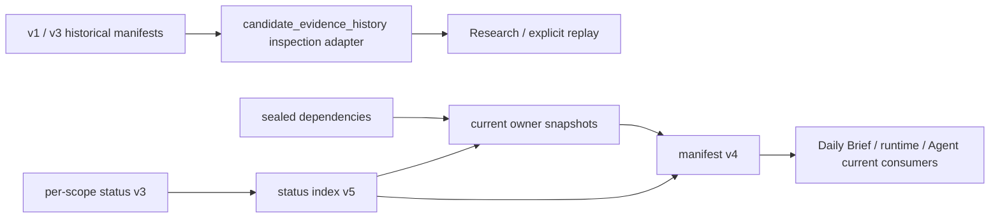

# Cash-Secured Put (CSP) / Covered Call (CC) 候选策略合同

> 状态：当前 `main` 策略合同
>
> 权威范围：CSP / CC 的召回、数据、筛选、容量、排序和候选快照
>
> 实施状态：以当前源码与测试为准；发布及部署状态分别以版本记录和目标环境运行证据为准

本文是 CSP / CC 开仓候选策略的唯一细则真源。产品域和依赖方向见
[STRATEGY_ARCHITECTURE.md](STRATEGY_ARCHITECTURE.md)；Combo Yield 保持独立策略，
不从本文件推导其组合筛选和排序规则。

## 1. 策略目标

### CSP

核心目标是承担“价格合适时接货”的风险，用权利金参与投资布局并获取收益：

- 愿意接货，但不主动追求接货；
- 按可执行的 `mid` 限价等待，不追价；
- 在现有 DTE 窗口内，偏好覆盖较长周期的一次性权利金；
- 正式比较整个持有周期的非年化净收益，不用年化收益主导排序；
- 接货能力必须真实存在，但候选不是自动下单或自动换汇授权。

### CC

核心目标是在愿意以合适价格卖出正股的前提下，用权利金增强持股收益：

- 愿意被叫走，但不主动追求被叫走；
- 按可执行的 `mid` 限价等待，不追价；
- 在现有 DTE 窗口内比较整个周期的非年化净权利金收益；
- 收益接近时优先更高行权价，降低在相近收益下被叫走的概率；
- 必须有普通股票可覆盖，不允许裸卖 Call。

## 2. 共同流水线与所有权

每个账户、市场和 run 使用同一条流水线：

1. 应用层一次性收集并冻结 OpenD 行情、合约、事件、持仓、现金、汇率和账本事实；
2. Candidate Engine 执行召回后的归一化、硬筛、容量计算和正式排序；
3. 生成不可变、可校验、已封存的账户级 opening decision snapshot；
4. Agent 和通知只消费该快照，不重新筛选或平行排序。

正式排序唯一所有者是：

- `domain/domain/engine/candidate_engine.py`

应用层不得再实现第二套评分、排序或候选裁剪。Combo Yield 可以共享标准化证据，
但必须使用 `strategy=combo_yield` 的独立策略结果，不能修改 CSP / CC 决策。

### 2.1 可复用 CSP / CC 核心

`om-strategy-core` 是 Python ≥3.12、仅依赖标准库的本地安装包，公共导出为
`om_strategy_core`。实现仍只有一份 `domain.domain`；费用、容量、集中度及排序
继续委托各自现有 owner。发行包不包含 OM 应用层、行情服务、存储适配器或运行配置。

| 入口 | 输入与结果 |
| --- | --- |
| `resolve_strategy` | 接收已合并政策、方向、账户/市场及可选 `template_id` / `template_version`，绑定有限代码表中的精确实现。 |
| `calculate_metrics` | 接收合约、显式带时区的决策时间或输入中封存的 `decision_now_utc`，以及 CC 成本；可传原始 FX，返回费用收益等指标。 |
| `calculate_constraints` | 接收冻结组合事实和已有资格的 FX，可传现金/持股容量输入，返回补充约束后的新行。 |
| `evaluate_candidates` | 只评价到达 underwriting 阶段的候选，分别返回所有决策、完整合格集合及每标的代表。 |

普通 CSP/CC 扫描入口只捕获一次实际决策时钟，按完整精度 UTC ISO 时间写入
`decision_now_utc`。成功候选及计算阶段提前拒绝均携带该字段，随规范化输入和
决策哈希进入账户级 opening snapshot；不同账户、方向或扫描调用可以使用不同时间。
它不是行情观测时间、调度时间或快照封存时间，也不会参与评分或排序。

离线 `calculate_metrics(row, mode=...)` 可直接读取该字段，无需取当前时间。
显式传入 `now_utc` 时必须带时区；与封存时间同时存在时，二者须为同一时刻。
缺失、无效或无时区的封存时间不能默认替换成当前时间。旧快照没有该字段仍可读取，
但不具备自动恢复历史决策时钟的条件；旧调用显式指定时间仍可做情景计算，不能据此
宣称恢复了真实历史时间。没有候选计算的空扫描不产生合约级决策时间记录。
离线复算入口是 `om_strategy_core.calculate_metrics`；应用层 scanner 的 `compute_metrics`
是扫描适配器，会重新规范化行情输入且不消费行内决策时钟，不能作为历史重放入口。
本字段补齐时钟证据，不代表完整收益回测或全部历史行为等价已经验收。

应用层继续负责配置合并、账户事实和行情资格检查。前置拒绝不会重新进入评价，
四项能力不合并或改变现有扫描、现金及 underwriting 阶段顺序。
独立调用 `evaluate_candidates` 前也须先运行 `calculate_constraints`，并传入其返回行。
若模板要求 `effective_min_strike`，评价入口拒绝缺失或无效的该字段，不在此阶段
重新计算容量或覆盖已冻结的行权价约束。
`calculate_capacity` 是约束能力的纯计算子入口：正式 CSP 现金阶段与 CC 持股阶段
传入冻结的 `PutCapacityInputs` / `CallCapacityInputs`，无需提前计算集中度。
CSP 保留原有 `//` 浮点边界、原币优先、占款、缺失和 FX 资格语义；OM 仍负责
账户和账本证据资格，demo 保留明确标识。
每个标的的愿买卖行权价单独绑定为输入；政策参数偏离基线时标记 `custom`。
CC 成本底价倍数 `min_strike_cost_multiplier` 在已有配置合并后冻结到 resolved
配置（默认 `1.02`），参与有效参数哈希和 `custom` 判定。扫描与 underwriting
消费同一冻结值；注入策略优先于旧 CC 配置。身份传输、恢复及重排均校验该参数，
缺失或非正有限数值的 resolved 身份拒绝消费；不影响无策略身份的 legacy 快照。
内置 `csp_baseline@0.1.0` / `cc_baseline@0.1.0` 委托既有规则。
冻结的 `StrategyTemplate` 描述符绑定约束、筛选、排序和解释；新增源码模板只需
实现并加入 core 的有限查找表，OM 消费者无需新增分支。没有公开注册 API、
外部模块加载器或生产切换配置。参数模式仍是 `InsuranceUnderwritingConfig`。
CSP 基线支持 `current_tie_break` / `concentration_first`，后者只改变跨标的代表顺序。

容量不足、必要 CNY 值缺失和财报覆盖资格由 Candidate Engine 的
`opening_qualification_rejects` 独立强制检查；已知财报事件如何处理属于可替换政策。
共享收益指标和 underwriting 注释仍由既有 owner 生成。模板约束只返回
`effective_min_strike` / `policy_*` 标量，不能改写价格、现金、数量或证据；
评价必须返回既有 opening decision，core 合并资格拒绝并保留规则顺序。
`rank_candidates` 对已评价集合调度模板，验证合约排列与事实不变；`explain_rank`
使用同一实现。summary 和快照均经过这些入口。
各实现的标的内代表不得依赖其他标的；基线保留输入相关尾序（第二次排序可能改变
尾序），新增模板必须采用确定性事实排序并对完整输出幂等。测试替代模板不随生产表发布。
策略身份保存在候选及 decision 的 `normalized_input.strategy_core` 中，
进入现有输入、决策和快照哈希链。新身份格式 `strategy_identity.v2` 将模板 id、
实现版本、有效参数、行权价输入及 rank preset 纳入政策摘要；同一 universe 不允许
混用身份格式、模板版本或账户/市场/方向/排序范围，允许标的参数不同。
旧 baseline 身份使用原哈希算法验证，仅已知精确版本可恢复执行。
摘要与解释使用同一身份，Brief 和通知保留已封存顺序。旧快照仍按原合同校验，
无身份行只在读取投影中标记 `legacy`，不改写历史文件或哈希。
封存读取只验证身份结构、范围和哈希，使用存储的顺序与解释，即使实现已不可用也能读；
新评价、重排或封存必须找到精确实现版本，否则明确失败。

FX 保持原始 `usd_per_cny`、`cny_per_hkd` 的运算顺序和舍入位置。
收入及 point value 的缺失补算与 CC `covered_notional_cny` 的 `setdefault`
语义分别保留。不能用派生倒数替换原始汇率来证明数值等价。

运行身份由 `om_strategy_core.runtime_identity` 在计算外读取：
源码及 editable 运行返回 `mode=source`、核心版本和空构建摘要；
隔离 wheel 运行须显式调用 `runtime_identity(mode="installed")`，
校验发行清单、代码内容及实际模块来源后才返回构建摘要。
源码模式不能证明正在执行某个已验证 wheel。
核心版本独立于 OM 的 `VERSION`；模板版本表示实现合同，与核心包版本独立。
可用 `python -m pip wheel --no-deps . -w <临时构建目录>` 构建本地包；
安装验证应在仓库外的干净虚拟环境执行。

包验证和合成回归不等于真实历史验收。阶段最终验收仍需 CSP、CC 的完整归档输入，
在固定旧提交、相同参数与时钟下逐字段精确比较。缺少合格归档时不能宣称阶段验收完成。
该源码变更也不构成发布或生产升级证据。

后续回测项目可引用同一核心；特征准备、历史数据质量与收益评估由该项目另行验证。
未来 Combo 保留独立多腿入口，Funding Put 使用完整合格集合，Long Call 不套用卖出
CC 的持股覆盖或成本底价。组合资金、风险和排序由组合 owner 决定，本期不扩展 Combo。

## 3. 共同报价与合约合同

### 3.1 市场状态与新鲜度

- 市场状态只认 OpenD `market_state`。
- 只有连续交易时段生成正式可参与候选；闭市返回 `market_closed`。
- 标的 spot 只认同一 run 的 OpenD `last_price + update_time + market_state + sec_status`。
- 标的 spot 在连续交易时段内不得超过 5 分钟；标的 `update_time` 是 OpenD 最新价更新时间。
- 期权 snapshot 的 `update_time` 同样只是最新价更新时间，不能证明 bid/ask 何时变化；
  它只作为最新价活跃度诊断，不再作为候选可用性门槛。
- 期权候选的 5 分钟窗口约束的是 OM 取得 OpenD snapshot 到完成候选决策的时间
  （`snapshot_age_seconds <= 300`），用每批请求的 request/receive receipt 证明。
- 每行保留产生该记录的成功批次 receipt：request 包含该批等待和重试的窗口，receive
  在返回后、记录转换前取得。后续批次或 fallback 不刷新已取得记录的时间；fallback
  只为新返回记录赋值。整次 fetch 的最早 request / 最晚 receive 仅作汇总诊断，
  不填补行级缺失时间；候选与估值适配器均逐字段使用对应记录的 receipt。
- 统一开仓证据入口在同一决策时钟下分别复核 `spot_observed_at_utc` 的源报价年龄和
  `snapshot_received_at_utc` 的取得年龄；显式回放时钟同样适用。源报价时间必须带时区，
  缺失、非法、未来或超过 300 秒均为 `evidence_unavailable`，恰好 300 秒仍可继续校验。
  不以 fetch 时的 `ready`、冻结年龄或期权 receipt 代替标的源时间；期权的
  `max_snapshot_age_seconds` 参数不改变标的独立的 300 秒门槛。
- 期权 bid/ask 的可用性由本次 snapshot 的盘口合法性（`bid > 0`、`ask >= bid`、
  tick、spread、合约身份与状态）判定，不由 `update_time` 判定。
- OpenD 明确返回 `bid=0` 且其余身份/盘口/状态证据完整时，视为当前无有效
  买盘的合法市场状态，合约归为 `ineligible`，不作为“证据缺失”告警；`bid`
  缺失、非有限或为负仍 `data_unavailable`。
- 不回退旧 required-data、CSV、收盘价或 `last` 作为 bid/ask 替代。
- 市场状态、spot 或关键时间戳缺失时，在最小受影响范围内 `data_unavailable`。

### 3.2 报价、价格档位和价差

```text
raw_mid = (bid + ask) / 2
spread_ratio = (ask - bid) / raw_mid
sell_limit = ceil(raw_mid / price_tick) * price_tick
```

- 必须满足 `bid > 0`、`ask > 0`、`ask >= bid`、`raw_mid > 0`。
- `spread_ratio <= 0.40` 是唯一通用流动性硬门槛。
- spread 使用原始盘口 `raw_mid`，不受价格档位向上取整影响。
- `price_tick` 使用同一合约、同一 run 的 OpenD `price_spread`；缺失、非正或冲突时合约不可用。
- 挂单、费用和收益计算都使用 `sell_limit`。

### 3.3 合约身份与交割物

- 只接受 OpenD `option_standard_type=STANDARD` 的标准合约。
- `stock_owner` 必须与目标标的一致，合约不得处于 suspended 状态。
- 交割物必须是普通股票；`NON_STANDARD` 合约直接拒绝，类型未知则不可用。
- multiplier 必须由同一合约的 chain 与 snapshot 绑定并一致。
- multiplier 缺失或冲突时只阻断该合约；不按标的缓存猜测，也不默认 `100`。
- 候选 ID 必须包含逻辑账户、物理 `futu_account_id`、市场、策略和合约身份。

### 3.4 可选观察字段

- OI 不设硬门槛，只在收益接近时参与排序。
- OI `0` 是已知值，必须与缺失区分；缺失排在可靠值之后。
- volume 只展示，不参与硬筛和正式排序；缺失显示 `—`。
- delta 不参与排序；普通 CSP/CC 的 delta 硬门槛见下节。
- bid/ask size 可作为诊断证据，但不新增硬门槛。
- OpenD IV 是百分号前数值，适配层固定除以 `100`；Delta 保持 `[-1, 1]`。

### 3.5 普通 CSP/CC delta 上限

Put 和 Call 各自默认 `max_abs_delta = 0.40`；旧配置省略此字段也启用该默认。显式 `null` 仅关闭本门槛，数字覆盖必须在 `[0,1]` 内且有限，拒绝布尔和字符串。只过滤 `abs(delta) > max_abs_delta`，等于保留；以原始精度判断，不能使用显示舍入值，也不把 `35` 猜成 `0.35`。真实零可以通过本门槛，仍须满足收益、期限、流动性等其他规则。

启用时，delta 必须来自同一身份匹配的 OpenD snapshot 的 `option_delta`，`delta_source=opend_market_snapshot.option_delta`、`delta_unit=fraction`。使用真实 `snapshot_received_at_utc` 对冻结 `decision_now_utc` 验证 0–300 秒的接收新鲜度。该证据只证明近期获取；提供方未暴露独立 Greek 计算时间，不能宣称计算时间已验证。缺失、陈旧、非有限、错误符号、单位或来源异常均拒绝并保留原因，不补零、不回填历史来源。

超过上限记录 `risk_delta`；不可验证记录 `risk_delta_unavailable` 及具体证据原因。旧 required-data 或快照缺少来源证据时，启用门槛会拒绝这些候选，可能整组无可用候选；不得静默放行或自动采集数据。此规则不改变 Wheel/Combo 自有策略，也不增加 delta 排序，同标的同方向仍允许跨到期日。0.40 是用户风险偏好，未经证明为收益或胜率最优值。

新 `csp_baseline` / `cc_baseline` 模板与策略核心版本为 `0.2.0`，effective parameters 将上限（包括显式 `null`）纳入策略身份 hash。历史 `0.1.0` 身份仍可读取校验，但当前核心不执行旧模板，也不把旧身份重解释为新默认。离线验证需要对应版本和足够冻结证据；OB 的旧源代码锁不能直接作为本版本的一致性证明，更新由 OB 独立任务负责。

回滚代码不回写已封存记录；旧版本可能拒绝新增配置字段，不能直接将包含新字段的配置交给旧版本。显式 `null` 关闭是新版本的配置能力，仍须通过正常配置预览与授权流程，本功能实现不修改任何生产配置。

## 4. 收益、费用与共同硬门槛

### 4.1 权利金和费用

```text
gross_premium = sell_limit * multiplier
net_premium = gross_premium - estimated_full_sell_fees
```

- 候选阶段使用版本化的富途官方费用表，并采用保守上界估算完整卖出费用。
- 当前已确认的平台费率输入包括：美股 `USD 0.60/contract`、港股 Tier 1
  `HKD 3/contract`；其他适用交易所、监管和平台费用仍须按版本化费率表完整计算。
- 实际业绩只认券商回传的真实费用，不用候选估算覆盖成交事实。

### 4.2 最低收益

- 单张合约净权利金折算后必须至少为 `CNY 50`。
- 年化净收益必须至少为 `10%`，但年化值只作硬门槛。
- 年化使用日历 DTE：`period_return * 365 / DTE`。
- 正式排序使用持有周期非年化净收益。

### 4.3 波动率边际

- `IV / term_matched_RV >= 1.10`；
- `IV - term_matched_RV >= 0.05`；
- 任一必要 IV/RV 证据缺失时，在最小受影响范围内不可用，不做回退。

## 5. CSP

### 5.1 召回窗口

保持现有市场和 symbol DTE 配置窗口。strike 召回按以下顺序计算：

```text
recall_upper = min(configured_max_strike, live_opend_spot)
```

未配置 `max_strike` 时使用 live spot。再从 `recall_upper` 向下召回 20%，并保留
显式、更严格的 `min_strike`：

```text
recall_lower = max(configured_min_strike, recall_upper * 0.80)
```

- `max_strike` 是愿意接货的最高价，spot 是自然上限。
- spot 缺失时 fail closed，不用旧 spot 或单独的 configured max 猜窗口。
- DTE 不增加额外加分；较长周期偏好通过持有周期收益自然体现。

### 5.2 收益口径

```text
assignment_notional = strike * multiplier
net_cash_basis = assignment_notional - net_premium
period_net_return = net_premium / net_cash_basis
annualized_net_return = period_net_return * 365 / DTE
```

- 主收益是 `period_net_return`。
- 收益分母继续采用扣除权利金后的净资金口径。
- 接货能力采用未抵扣权利金的 gross `assignment_notional`，两者不得混用。

### 5.3 现金担保能力

- 只在同一物理 Futu 账户内计算，不跨物理账户聚合。
- 先使用合约同币种资金；不足部分再按 OpenD 汇率折算其他币种资金。
- 不对跨币种资金增加 `0.95` 或其他通用安全折扣。
- 跨币种汇率从 `observed_at` 起最长有效 24 小时；时间缺失或超过 24 小时即为 stale。
- stale / missing FX 对应的外币资金不参与覆盖；同币种资金仍可使用。只有确实需要该外币
  才能达到一张合约时，候选因资金证据不足 fail closed。
- 保留当前现金组成：明确的分币种 cash 加 OpenD `fund_assets`。
- 已知限制：OpenD `fund_assets` 是聚合基金资产，无法区分普通基金与货币基金；本策略接受当前口径。
- 已有开放 Short Put 先按 gross `strike * multiplier` 扣除担保占用，不抵扣历史权利金。到期日和随后一个自然日仍计入，以覆盖指派结算窗口；自到期后第二个自然日起，过期 lot 可继续保留在生命周期视图中，但不再作为当前期权担保占用。
- 不额外读取或扣除待成交挂单、`frozen_cash`；操作员负责避免候选间重复使用。

```text
max_new_contracts = floor(effective_free_cash / assignment_notional)
```

- `max_new_contracts >= 1` 才具备开仓能力。
- 各候选共享同一现金池，候选容量不能相加。
- 每张候选按一张合约计算收益、费用和 CNY 50 门槛；实际数量由操作者决定。

### 5.4 不作为硬门槛的指标

以下指标不阻断 CSP 候选：

- stress / gap-down / sigma stress；
- 路径压力和资本 charge；
- delta 下限分带（上限按 §3.5 执行）；
- 单笔、单标的或总组合集中度；
- OI、volume、bid/ask size。

集中度只在跨标的且收益接近时参与排序。

### 5.5 排序

1. 仅排序全部硬门槛通过且容量至少一张的候选。
2. 以最高 `period_net_return` 为锚，将与其差值不超过 `0.002` 的候选组成收益区间，再处理下一组。
3. 同一标的、同一收益区间内依次比较：
   - 更高净接货折价；
   - 更小 spread；
   - OI 已知优先，再比较更高 OI；
   - 更高净权利金；
   - 稳定合约 ID。
4. 每个标的先选一张代表合约。
5. 不同标的、同一收益区间内依次比较：
   - 较低的接货后 symbol concentration；
   - 更高净接货折价；
   - 更小 spread；
   - OI 已知且更高；
   - 更高净权利金；
   - symbol 和合约 ID。

```text
breakeven = strike - net_premium / multiplier
net_assignment_discount_pct = (spot - breakeven) / spot
```

## 6. CC

### 6.1 strike 底线与召回窗口

```text
sale_floor = max(configured_min_strike, opend_average_cost * 1.02)
recall_min = max(sale_floor, live_opend_spot)
recall_max = recall_min * 1.20
```

如果配置了 `max_strike`：

```text
recall_max = min(configured_max_strike, recall_min * 1.20)
```

- 保持现有 DTE 配置窗口。
- spot 缺失时 fail closed。
- `recall_max < recall_min` 表示当前没有可行窗口，返回等待，不改写边界。
- OM `avg_cost` 的唯一定义是平均成本价，直接映射同一物理账户、同一 symbol 的 OpenD `average_cost`。
- OpenD `cost_price` / `diluted_cost` 是摊薄成本口径，不得写入或回退为 OM `avg_cost`。
- OpenD `average_cost` 缺失时成本上下文 fail closed；不跨账户平均。

### 6.2 收益口径

```text
current_market_value = live_opend_spot * multiplier
period_net_premium_return = net_premium / current_market_value
annualized_net_premium_return = period_net_premium_return * 365 / DTE
```

- 主收益是整个持有周期的 `period_net_premium_return`。
- 分母使用当前市值，不使用历史成本或 strike。
- 年化收益只作 10% 硬门槛。
- 可展示被叫走时的事实收益，但该指标不参与开仓排序。

### 6.3 覆盖能力

- 持仓事实来自同一物理 Futu 账户的 OpenD `qty`、`can_sell_qty`、`average_cost` 和 currency；其中 `average_cost` 映射为 OM `avg_cost`。
- symbol 配置可以在多账户间共用；当前账户未持有该 symbol 时，该 CC scope 以 `covered_call_underlying_not_held` 正常跳过，不会将其他已完成 scope 降级为 `data_unavailable`。
- 若当前账户的 CC scope 全部因未持股而跳过，账户级结果是合法的 `no_candidate`；持仓上下文缺失或损坏仍为 `data_unavailable`。
- 单个标的因待结算、行情或其他局部证据缺失而受阻时，只保护该标的容量；其他标的继续筛选和排序。存在合格候选时策略为 `candidates_found`，其他标的已完成但无候选时为 `partial_data`，缺口保留具体 symbol；全部不可用或共享持仓上下文缺失仍为 `data_unavailable`。
- 已开放 Short Call 的股票锁定来自权威 SQLite option-position ledger。
- OpenD 持仓与 SQLite short-call 锁定无法一致解释时 fail closed。
- 不跨账户借用股票，也不默认 multiplier。

```text
shares_available_for_cover = min(qty, can_sell_qty) - shares_locked_by_open_short_calls
max_new_contracts = floor(shares_available_for_cover / multiplier)
```

- `max_new_contracts >= 1` 才可进入候选。
- 不另行扫描待成交挂单；OpenD `can_sell_qty` 作为券商当前可卖事实。
- 交割物就是普通股票。

普通持股与 CSP 指派股混合且无法归属时，股票仍可按账户总量判断覆盖能力，
但保持未分配，不计算批次级 Wheel 收益。只有显式 `stock_lot_id` 或充分 FIFO 证据
才能把 CC 归属到指定指派批次。

### 6.4 不作为硬门槛的指标

以下指标不阻断 CC 候选：

- gap-up opportunity cost；
- path stress；
- delta 下限分带（上限按 §3.5 执行）；
- 单标的集中度；
- OI、volume、bid/ask size。

### 6.5 排序

1. 仅排序全部硬门槛通过且容量至少一张的候选。
2. 以最高 `period_net_premium_return` 为锚，将差值不超过 `0.002` 的候选组成收益区间。
3. 同一标的、同一收益区间内依次比较：
   - 更高 strike，从而降低相近收益下被叫走概率；
   - 更小 spread；
   - OI 已知优先，再比较更高 OI；
   - 更高净权利金；
   - 稳定合约 ID。
4. 每个标的先选一张代表合约。
5. 不同标的、同一收益区间内依次比较：
   - 较低的被叫走后剩余 symbol concentration；
   - 更大的 strike-above-spot 距离；
   - 更小 spread；
   - OI 已知且更高；
   - 更高净权利金；
   - symbol 和合约 ID。

`strike_above_spot_pct` 与 `strike_upside_margin_pct` 均保留 Candidate Engine 计算的相对现价距离；承保底价只参与行权价门槛，不改写这两个字段。

## 7. 期限匹配 RV

CSP 与 CC 使用完全相同的正式 RV：

1. 已完成前复权（QFQ）日线和历史／当年交易日由 OpenD 提供；有完整权威来源证据的未来 HK 计划交易日按下述规则补齐；
2. 计算从扫描时点到到期日剩余的交易 session 数；
3. `lookback = max(20, remaining_trading_sessions)`；
4. 使用已完成收盘价的对数收益；
5. 使用样本标准差并乘以 `sqrt(252)` 年化；
6. 得到唯一 `term_matched_RV`，参与 IV/RV 两个硬门槛。

RV20 / RV60 / RV120 只保留为诊断字段，不加权生成正式 RV。历史不足时不可用，
不回退其他窗口，也不重新归一化。

现有 OpenD 连接可能成功返回空的跨年交易日历，或将混合范围截在当年；空返回不能证明
未来全年休市。历史／当年前缀与未来范围分别查询，未来查询异常不影响已有健康期限。
HK 正股在2026扫描时，未来2027计划交易日可使用随代码版本携带的 HKEX/SEHK 通告
[CT/077/26](https://www.hkex.com.hk/Services/Circulars-and-Notices/Participant-and-Members-Circulars/SEHK/2026/SEHK_CT_077_2026Jun01162846?sc_lang=en)
补齐。该通告明确列出2027全年周末和假期休市规则、3个半日市；半日市计一个日线 session，
不据此推断上午／下午方向。它用于正股收盘序列，不把期权到期表、公众假期表或普通工作日
单独当作完整交易日证明，也不替代历史实际行情。

源快照记录通告版本、发布日期、原始 PDF 摘要和适用范围；RV 的 `trading_calendar`
保留各来源、数据摘要与覆盖证据，不把 HKEX 计划日标成 OpenD 实际返回。来源冲突、
源损坏、未来查询异常及2028等未覆盖期限分别保留明确缺口，同批健康期限继续计算。
原始 OpenD 日历缓存与补齐结果分开，后续年份的历史日仍须由 OpenD 证明。
无新增运行时 HTTP、自动更新器或配置开关；交易所修订或新年度数据需另行审核更新。
年度计划日历不能预测临时休市。

覆盖边界不以最后返回的交易日推断，因此周末、节假日到期不会仅因当日无交易 session
被拒绝。日历顶层 `status=ok` 只表示历史／当年前缀取数有效，不代表全部目标期限已覆盖；
目标期限和连续支持区间分别记录为 `requested_end` 和 `coverage_end`。单个期限不可用时，
其 `term_matched_rv_status=data_unavailable` 并保留真实原因，RV 总体状态为 `partial`。
未知交易日类型（包括 SDK 的 `N/A`）使日历证据不可用，不能当作休市日丢弃。
历史／当年前缀的全天、半日交易及既有空类型、`TRADING` 输入保持兼容；明确的
`NON_TRADING` 不计入 session。
未来来源核对保留原始日期和日类型，矛盾或未知类型不通过日期去重消失。
Daily Brief 的 RV 缺口提醒保留具体到期日与原因，同到期档多个行权价合并展示；
不同到期档或原因分别保留，不能将局部缺口表述为所有期限 RV 均不可用。

日线缓存按 `market + symbol + QFQ` 持久化共享：

- 不在每次 intraday run 全量重复抓取；
- 新的已完成交易日出现时增量更新；
- 每次回抓最后 5 个 session 以吸收修订；
- 发现 QFQ 历史修订时刷新所需完整区间；
- 每次 run 仍按目标 expiry 重新计算期限匹配 RV，并记录输入区间与 hash；
- 缺口或更新失败只使受影响 expiry 不可用。

每页 QFQ 日线先核对每行证券 `code` 与请求身份一致，再归一化并缓存；缺失、混入其他证券
或后续分页失败均不得发布成功缓存。未做身份验证的 v1 缓存不再复用，下次通过既有限流
重新取得完整区间并验证成功后写入 v2；失败保留原文件且不回退为可用证据。

新算法先与旧算法做 shadow comparison，再晋升为正式口径。

## 8. 财报风险

### 8.1 唯一数据源

- 唯一正式来源是 OpenD `get_earnings_calendar`。
- 删除 yfinance 依赖、fallback、probe、配置和事件实现。
- 不再使用 `get_financials_earnings_price_history` 证明未来覆盖，也不预测财报日期。
- Futu SDK 与 OpenD 必须支持财报日历接口；不支持时相关范围 `data_unavailable`。

### 8.2 获取与完整性

- 每个市场、每个 run 只获取一套市场级财报日历，所有账户和 symbol 共享。
- 从扫描日到本轮最远 expiry 按最多 7 天的连续、不重叠区间查询。
- 查询起点使用扫描日，是为了保留“今日至到期前”的已知事件语境；它不是硬筛窗口的起点。
- 每个 expiry 独立分为硬窗口 `max(扫描日, expiry-6天)..expiry` 和软语境窗口 `扫描日..expiry-7天`。
- 硬窗口相关区间全部成功后，OpenD 未列出某 symbol 才能证明该 expiry 的临近窗口内没有已知财报。
- OpenD 不提供单 symbol 的覆盖完整标记；本策略明确接受“以 OpenD 当前已知日历为准”的剩余风险。
- 硬窗口区间失败时，只阻断仍需要该区间才能判定的 expiry；若已有可验证的硬窗口财报事件，该合约仍可确定拒绝。软窗口失败只标注语境不完整，不阻断候选。

### 8.3 筛选

- 财报日与 expiry 的自然日差为 `0..6` 天时拒绝；第 7 天及更早的已知事件仅保留为软风险语境。
- expiry 当天为第 0 天，`expiry-6天` 为第 6 天，两端都包含。
- 按市场本地日期判定；扫描当天的财报全天视为尚未发生，不使用 `earnings_timestamp` 或 `pub_type` 把它判为已发生。
- 硬窗口完整且无事件可以通过；硬窗口证据不完整时 fail closed，但不影响其他已完整证明的合约继续入选。
- 该规则统一用于 CSP、CC 和 Combo Yield Funding Put，不为 Combo Yield 设置第二套窗口。

## 9. 运行状态与失败范围

账户/run 的正式结果只使用以下状态：

- `candidates_found`
- `no_candidate`
- `data_unavailable`
- `partial_data`
- `market_closed`

失败按最小范围传播：

- 账户事实失败：阻断该账户；
- symbol 事实失败：阻断该 symbol；
- expiry chain 或财报覆盖失败：阻断相关 expiry；
- 单合约 snapshot、multiplier、tick 或报价失败：阻断该合约。

执行终态由 `strategy_scan_status` 发布并进入绑定 run/account/config 的索引；快照与 Brief 不再维护另一套捕获终态。`completed` 且零候选必须有有效执行结果。`None`、缺少数量或无效终态属于执行失败，不能当成正常空结果。来源 `success_empty/no_expirations`、`success_empty/no_contract_rows` 与策略 `no_candidate` 分别保留，`candidate_scope_reason` 统一投影到当前快照。

策略执行先缓冲候选与诊断，校验结果后再发布终态和提交证据；执行异常丢弃该步骤缓冲，其他步骤继续。终态发布、证据提交或账户级 hash/身份不一致时停止封存。标的超时只给尚未完成的步骤写失败，已完成步骤保持不变；工作线程在下一步与发布前检查同一绝对截止时间，不能强制中断正在运行的外部调用。冻结输入缺失不能回退读取可变 CSV。

Wheel 在标的计算与分支评估边界隔离异常，资金和股票仍由账户共享分配。Brief 从已验证快照保留健康候选；历史候选仅在相同 symbol、策略、方向、Combo owner、Wheel 分支或合约的证据缺口下转为待核验。`candidate_universe_summary.affected_scopes` 在合约身份可用时携带 `scope=contract`、`contract_symbol`、`expiration`；没有细分证据时保留原策略范围。执行日志只补充匹配失败终态的诊断，不覆盖快照中的健康结果。

OI、volume 等可选字段缺失不产生 `partial_data`；启用 delta 门槛时，delta 不可验证必须保留独立拒绝原因。

每个账户/run 即使无候选也必须封存 snapshot，并包含 `scope_results`。snapshot 必须：

- 绑定 run、账户、物理账户、市场、策略与配置/证据 hash；
- 区分 `strategy_status`、`capacity_status` 和最终 `opening_status`；
- 完成后不可变；
- 通过 seal/hash 校验后才能被 Agent 或通知消费。

Candidate Agent 工具必须显式提供 account。run 可省略，但只能解析到该账户最新已封存且
hash 有效的 snapshot；不允许调用方传任意文件系统路径。

## 10. 组合口径与消费边界

### Position Sizing（单账户 CSP / CC）

三个比例使用同一逻辑账户的冻结资产证据：当前仓位；该标的已有同方向 Short Option 全部指派后；
再卖该候选一张并同方向全部指派后。CSP 仅模拟 Short Put，CC 仅模拟 Short Call，两个方向不相互抵消。
这是冻结现价下的极端交付情景，不是股价压力测试或最大亏损测算。
股票按同一现货价格计市值，现金按行权价同时增减，使用实际合约乘数。
分母为有符号的非期权净资产（现金、MMF 与非期权持仓，包含负现金），每个场景重新计算：
`N_after = N_before + delta_shares * spot + delta_cash`。
已有权利金已在现金中，不重复添加；候选只添加一次扣除开仓费用后的净权利金。三个场景统一为指派费用前。

资产源沿用 `portfolio.holdings.enabled`：富途基线，开启后补充经批准的 PM 非富途资产，排除 PM 富途副本。
普通股票采用冻结现价和 FX，不以平均成本补值。计算由 `domain/domain/portfolio_assignment_scenario.py` 持有；
`short_vol_assessment.py` 选择场景，摘要、开仓快照与 Brief 透传，不重新取价。
字段为 `symbol_concentration_current`、`symbol_concentration_after_existing_assignments`、
`symbol_concentration_after`，候选以 `position_sizing_basis=directional_non_option_net_assets_before_assignment_fees.v3`
标明方向隔离口径，并保留三个场景的净资产分母。
已有封存快照不修改，v2 及旧 `symbol_concentration_after_existing_puts` 仍按历史口径展示。

展示位置是 CSP / CC 候选指标，使用“Position Sizing：当前 · 指派后 · 再卖 1 张指派后”，
不增加括号说明或休市报价估值行；计算口径和报价证据仍保留在快照中。事件仍在独立回执区。缺失显示暂不可用，可信零值显示 0%，
负仓位与超过 100% 的仓位保持原值；净资产非正时比例不可用。期权证据缺失不影响可确认的当前仓位；
候选净权利金缺失只影响第三项。排序统一消费第三项，保持原方向、优先级与缺失值顺序；
不新增集中度硬门槛，富途执行资金容量和 CC 实物覆盖仍由原 owner 计算。

- concentration 只在跨 symbol 且收益接近时参与选择，不变成硬风险门槛。
- 美股和港股使用同一套公式、状态和失败范围；市场配置窗口、费用表、时区和交易日历分别取对应市场事实。
- opening snapshot 只负责开仓候选和容量事实。它不为已有持仓生成
  `hold / replace / reallocate` 决策，Close Advice 也不消费候选来比较换仓。
- 可以复用现有 producer payload / receipt 基础设施，但 opening candidate domain
  拥有 payload、seal、hash 和状态语义。
- 人工没有导出 CSV 查看需求，正式分析入口是 Agent。CSV/JSONL 不再是公共合同或事实真源。
- 候选容量是建议能力，不授权自动下单、自动换汇、自动滚动、自动接货或自动叫走。

## 11. 已确认决策索引

本节用于逐项核对本轮对话中已确认的问题。详细计算以对应正文为准；索引本身不建立
第二套规则。

### 11.1 策略与排序

| ID | 已确认结论 | 正文 |
|---|---|---|
| S01 | CSP 是愿意按合适价格接货并赚取权利金，不主动追求接货 | §1、§5 |
| S02 | CC 是愿意按合适价格卖股并增强收益，不主动追求被叫走 | §1、§6 |
| S03 | 两者都按可执行 mid 限价等待，不追价 | §1、§3.2 |
| S04 | 保持现有 DTE 召回和筛选窗口，不新增 DTE 奖励 | §5.1、§6.1 |
| S05 | 主收益统一为整个周期的非年化净收益；年化只作 10% 硬门槛 | §4.2、§5.2、§6.2 |
| S06 | CSP 收益分母使用扣除净权利金后的净资金 | §5.2 |
| S07 | CC 收益分母使用正股当前市值 | §6.2 |
| S08 | 单张合约净权利金至少 CNY 50 | §4.2 |
| S09 | IV/RV 同时满足 ratio 1.10 和 spread 0.05 | §4.3 |
| S10 | spread 40% 是硬门槛；OI 只在收益接近时排序，volume 只展示；delta 按 §3.5 硬过滤 | §3.2、§3.4 |
| S11 | `0.002` 使用锚定收益分组，不使用非传递性的两两“接近”比较 | §5.5、§6.5 |
| S12 | 每个 symbol 先选一张代表合约，再做跨 symbol 排序 | §5.5、§6.5 |
| S13 | CSP 同 symbol 收益接近时优先净接货折价、spread、OI、净权利金 | §5.5 |
| S14 | CC 同 symbol 收益接近时先选更高 strike，再看 spread、OI、净权利金 | §6.5 |
| S15 | 跨 symbol 时 concentration 仅作接近收益的排序参考，不作硬门槛 | §5.5、§6.5、§10 |
| S16 | stress、gap、path、gamma、vega 和旧评分不进入正式开仓决策 | §5.4、§6.4、§12 |

### 11.2 召回、容量与资金

| ID | 已确认结论 | 正文 |
|---|---|---|
| C01 | CSP 先取 `min(max_strike, spot)`，再从该上界向下召回 20% | §5.1 |
| C02 | CSP 显式 `min_strike` 继续作为更严格下界 | §5.1 |
| C03 | CC 最低卖价为 `max(min_strike, avg_cost*1.02)` | §6.1 |
| C04 | CC 召回最小值再与 spot 取大，最大值为其上方 20% 并受 configured max 限制 | §6.1 |
| C05 | 现金、持仓和锁定全部按物理 Futu 账户隔离 | §5.3、§6.3 |
| C06 | CSP 先用同币种现金，不足部分按新鲜 OpenD 汇率折算其他币种 | §5.3 |
| C07 | 跨币种资金不保留 0.95 或其他安全折扣 | §5.3 |
| C08 | 现金组成保留当前 `cash_by_currency + fund_assets` 口径，货币基金算入 | §5.3 |
| C09 | 已有 Short Put 在到期后一日缓冲期结束前按 gross strike notional 占用担保 | §5.3 |
| C10 | 不考虑 CSP 待成交挂单或 frozen cash，候选共享资金不可相加 | §5.3 |
| C11 | 每张候选按一张合约计算，最大张数用资金或股票整除 multiplier | §5.3、§6.3 |
| C12 | CC 使用 OpenD qty/can_sell_qty 和 SQLite 已开放 Short Call 锁定 | §6.3 |
| C13 | 普通持股与指派股混合可用于账户级覆盖，但无法归属时不算批次 Wheel 收益 | §6.3 |
| C14 | 交割物是普通股票，不支持裸 Call 或非标准交割 | §3.3、§6.3 |
| C15 | 组合集中度延续当前 NAV 口径，按当前市值且货币基金计入 | §10 |

### 11.3 OpenD 数据合同

| ID | 已确认结论 | 正文 |
|---|---|---|
| D01 | 正式市场数据只认 OpenD，不回退旧 CSV、last 或其他行情源 | §3.1 |
| D02 | OpenD market_state 决定连续交易、闭市和不可用状态 | §3.1 |
| D03 | spot 只认 live OpenD last_price 及同一份状态/时间/证券状态证据 | §3.1 |
| D04 | 标的 spot 在连续交易时段使用 5 分钟最新价新鲜度；期权使用 OM 取得 snapshot 的 5 分钟取得新鲜度，期权 `update_time` 仅作活跃度诊断 | §3.1 |
| D05 | mid、spread 和向上取整的卖出限价使用同一合约 snapshot 与 price tick | §3.2 |
| D06 | 只接受 STANDARD、stock_owner 匹配、未停牌、普通股票交割合约 | §3.3 |
| D07 | multiplier 必须 chain/snapshot 合约级一致，不默认 100 | §3.3 |
| D08 | OpenD IV 从百分数除以 100，Delta 保持 `[-1,1]` | §3.4 |
| D09 | OI 0 与缺失分开；可选 OI/volume 缺失不产生 partial_data；delta 不可验证独立记录 | §3.4、§9 |
| D10 | 正式 RV 是按剩余交易 session 匹配的唯一指标，RV20/60/120 仅诊断 | §7 |
| D11 | RV 日线持久化缓存、增量更新、回抓 5 个 session，QFQ 修订时刷新 | §7 |
| D12 | 美股与港股共享算法，只使用各自 OpenD 日历、时区、费用和配置 | §10 |
| D13 | 候选费用使用版本化官方保守全费用，成交业绩使用券商真实费用 | §4.1 |
| D14 | 汇率唯一正式来源是 OpenD，最长有效 24 小时；stale 外币不参与，同币种资金仍可用 | §5.3 |
| D15 | snapshot 缺单合约只阻断该合约，chain 缺单 expiry 只阻断该 expiry | §9 |

### 11.4 财报

| ID | 已确认结论 | 正文 |
|---|---|---|
| E01 | 财报是 CSP、CC 与 Combo Yield Funding Put 的临近到期硬风险 | §8.3 |
| E02 | 唯一正式来源为 OpenD `get_earnings_calendar` | §8.1 |
| E03 | 删除 yfinance，包括依赖、fallback、probe、除息/拆股和事件实现 | §8.1、§12 |
| E04 | 不用财报价格历史证明未来覆盖，也不预测财报日期 | §8.1 |
| E05 | 每个市场/run 查询一次，按最多 7 天分段覆盖到最远 expiry | §8.2 |
| E06 | 每个 expiry 的硬窗口完整后，空结果才证明该窗口无已知财报 | §8.2 |
| E07 | expiry 前 0..6 个自然日内的财报拒绝，第 7 天及更早仅作软语境 | §8.3 |
| E08 | 扫描当天的财报全天视为尚未发生，不按 timestamp/pub_type 转为历史事件 | §8.3 |
| E09 | SDK/OpenD 不支持财报日历时不可用，不回退其他来源 | §8.1 |
| E10 | 硬窗口失败只阻断结果未决的受影响合约；软窗口失败只标注语境不完整 | §8.2、§8.3 |

### 11.5 快照、状态与代码收敛

| ID | 已确认结论 | 正文 |
|---|---|---|
| A01 | 账户/run 状态为 candidates_found、no_candidate、data_unavailable、partial_data、market_closed | §9 |
| A02 | 失败按账户、symbol、expiry、contract 的最小范围传播 | §9 |
| A03 | 每个账户/run 即使空结果也封存包含 scope_results 的不可变 snapshot | §9 |
| A04 | Candidate Engine 是唯一正式过滤/排序所有者 | §2 |
| A05 | Candidate ID 包含逻辑账户和物理 futu_account_id | §3.3 |
| A06 | Agent 查询必须给 account；省略 run 只能取最新 seal/hash 有效 snapshot | §9 |
| A07 | 开仓候选与已有持仓处置彻底分离，不生成 replacement/reallocate | §10 |
| A08 | Combo Yield 只共享标准化证据，保留独立策略和 snapshot | §2 |
| A09 | 人工不依赖 CSV 导出；Agent 是正式分析入口 | §10 |
| A10 | 删除 runtime 候选 CSV 流水线、重复候选 artifact 和旧字段；JSONL 仅作审计追踪 | §12 |
| A11 | 开仓候选不考虑自动下单、自动换汇或自动归属 Wheel 批次 | §10 |
| A12 | 当前代码与目标合同的差距必须明确，不能把文档目标声称为已上线 | §13 |

## 12. 明确删除或退出正式路径

以下内容不再进入正式候选决策：

- yfinance 全部运行依赖及事件模型；
- 通用 ex-dividend / split 事件门槛；
- 旧的多数据源事件 resolver、fallback、stale event store 和重复事件 artifact；
- RV20/60/120 分档加权正式算法；
- `strategy_score`、`premium_edge_score`、`risk_distance`、`path_risk_score`、
  gamma、vega、gap-up/gap-down 等旧开仓评分；
- OI / volume 硬门槛；
- 第二套 application 排序；
- runtime 候选 CSV 流水线和重复候选 artifact；JSONL 只保留为非权威审计证据；
- multiplier `100` 默认值、旧 spot/last/CSV fallback；
- 旧字段、旧 CLI 参数和只为已删除决策保留的兼容读取。

历史 artifact 可以继续只读解释，但不能重新进入当前开仓候选路径。

## 13. 当前实现状态

当前 `main` 已实现本合同：

- 正式开仓候选使用 OpenD 报价、合约、市场状态、财报日历、QFQ 日线、
  交易日历和汇率证据；
- 期限匹配 RV 是 Candidate Engine 唯一正式 RV；RV20/60/120 和旧加权值只保留为
  诊断或离线 shadow 对照，不进入正式 decision；
- CSP / CC 的计算、硬筛和排序由 Candidate Engine 唯一所有；
- 现金、汇率、持仓与锁定能力绑定物理 Futu 账户，OpenD FX 最长有效 24 小时，
  无 `0.95` haircut；
- 每个账户/run 封存不可变 `opening_candidate_snapshot.v3`，并由最后发布的
  `candidate_snapshot_manifest.v4` 绑定完整 owner/scope；Agent 和 Daily Brief 只通过
  terminal manifest gate 读取同一封存事实，不会挽救未完成运行中的单个 owner；
- yfinance、旧事件 resolver、旧开仓评分、runtime 候选 CSV 权威路径和重复候选
  artifact 已退出当前开仓路径；JSONL 只保留为当前决策追踪证据，历史候选文件只在
  research/archive/shadow 的受限元数据分类边界中识别且不再解析。

当前标准扫描只写一套可执行合同：

| 角色 | 当前 schema / 文件 |
|---|---|
| 单范围终态 | `strategy_scan_status.v3` / `*_scan_status.v3.json` |
| 账户终态索引 | `strategy_scan_status_index.v5` / `strategy_scan_status_index.v5.json` |
| Opening owner | `opening_candidate_snapshot.v3` / `opening_candidate_snapshot.json` |
| Combo Yield owner | `combo_yield_candidate_snapshot.v4` / `combo_yield_candidate_snapshot.json` |
| CC+LP owner | `cc_lp_candidate_snapshot.v4` / `cc_lp_candidate_snapshot.json` |
| Wheel owner | `wheel_candidate_snapshot.v3` / `wheel_candidate_snapshot.v3.json` |
| 账户终态提交 | `candidate_snapshot_manifest.v4` / `candidate_snapshot_manifest.v4.json` |

`scan_mode`、`executable` 和 Wheel `direction` 都是已校验的数据字段，不再靠选择旧文件名
表达运行分支。标准扫描依赖集合固定为 `required_data`、`portfolio`、`ledger`、`fx`、
`earnings_rv`。体验扫描使用独立的非执行合同，只允许 `required_data`、`fx`、
`earnings_rv`，且必须是 `scan_mode=experience`、`executable=false`，不得携带真实账户
authority。



当前消费者遇到 v1/v3/v4 混存、旧索引、旧 Wheel 文件或封存后的额外候选文件时直接
失败。v1、v3 正式历史 bundle 只由 `candidate_evidence_history` 在显式 inspection/replay
入口读取并标为受限历史证据；当前执行路径、Daily Brief 和新 runtime assembly 不协商旧
版本，也不重写或删除历史 artifact。

发布记录只证明源码和产物已交付。受控远程升级是独立授权边界；在完成升级和运行时
验证前，不得宣称目标环境已按本合同运行。

## 附：CC+LP（CC + Long Put）变体

CC+LP 是 `combo_yield` 模块下的同到期变体（`combo_yield.variant=cc_lp`）；策略边界见
[Strategy Architecture](STRATEGY_ARCHITECTURE.md)，组合校验实现见
`domain/domain/engine/cc_lp.py`：

- 定位：CC 资金腿（收权利金、承担被叫走风险）+ Long Put 看跌反转腿（表达转跌观点），
  与 SP+LC 严格对称，不是保护/保险；
- CC 腿独立扫描，继承 CC 全部硬门槛（收益下限、`max(min_strike, avg_cost*1.02)`、max_strike、流动性、期限），
  无持仓上下文 → `not_applicable` 跳过；
- Long Put 反转腿默认 `0.15 ≤ |delta| ≤ 0.35`，通过 `combo_yield.put.min_delta/max_delta` 覆盖；排序次键目标仍为 0.12；
- Long Put 成腿前复用统一开仓证据校验和规范化数值，在决策时复验期权 snapshot 的 300 秒取得时效；证据不可用与合法零候选分别保留，混合结果沿现有状态 owner 标为 `partial_data`；
- 结构方向 `call_strike > put_strike`（复用 `strike_order` 角色参数化）；
- 保留率 `net_credit / call_net_credit` 默认至少为 `0.20`，可由显式 `combo_yield.min_net_credit_retention` 覆盖；未配置或为 `null` 时保持 `0.20`，不采用 SP+LC 的通用 `0.60` 默认值；不允许净 debit/自掏腰包，无 gap 硬门槛（`gap_width_pct` 仅诊断）；
- 资金占用 = 持仓当前市值 `spot * multiplier`（1 张合约覆盖股数），不扣净权利金；
- 排序：保留率主键，次键反转腿 delta 趋近 0.12，再 spread/OI；
- 候选写入独立 `cc_lp_candidate_snapshot.v4`，Daily Brief 加载快照到数据源（不渲染）；
- 当前不启用（`combo_yield.variant` 默认 `sp_lc`），启用由运行时配置决定。

## 14. 排序键的有限数值契约

目标是让缺少可选集中度或价差的候选排序键可以被严格 JSON 快照封存，同时保持既有
比较优先级和缺失排后语义。本节覆盖公共 Candidate Engine 排序键及其 Wheel Call/Put
消费者；不计算缺失的账户事实，不改变策略门槛、容量、快照 schema 或生产状态。

排序 owner 是 `domain/domain/engine/candidate_engine.py`。集中度排序使用
`(missing, value)`，缺失时值槽为有限占位 `0.0`，仅由 missing 决定缺失排后；占位值不
代表真实集中度。统一使用 `_known_low_sort` 的缺失标记和值槽，并将该 helper 自身的缺失值改为
有限占位；三处集中度 helper（包括 option-market profile）复用它。价差使用同一
helper，已知价差仍按升序。
Wheel 保留公共排序键，容量分配保留候选证据，快照校验继续拒绝无穷大。

当前故障链是公共排序键产生 `inf`，Wheel 扫描/容量分配保留该键，封存递归校验拒绝它，
账户 pipeline 随即失败。修复落在公共生成端；不采用下游清洗、放宽 JSON 校验、丢弃排序
证据或为未知集中度伪造业务事实的方案。除缺失值表示外，收益优先级和比较结果必须保持。

实现作为一个可验证增量：替换上述非有限占位，扩展既有排序测试与 Wheel 扫描测试。
验收包括 Call/Put 缺失及已知值的相对顺序、已知零值、多个缺失候选的后续 tie-break、严格 JSON
序列化，以及真实 Wheel Call 扫描 → 容量分配 → 封存 → 回读。回读须保持 raw/final 候选的外层和嵌套排序键（允许 tuple 转 list），缺失集中度事实
仍缺失且结果为 `candidates_found`。公共键、underwriting、Wheel 键及收益分带排序
分别保持各自原有比较结果，不统一算法或改变 OI 缺失语义。快照仍应拒绝直接注入
候选排序证据中的真实无穷大；测试仅使用隔离 fixture，不能调用 OpenD 或发送通知。

风险是价差缺失标记增加排序元组的一个槽位：实现前核查所有消费者，禁止假定固定索引
或跨版本混排旧键。既有封存快照不重写，hash 不变。若发现必须迁移外部 schema 或改变
策略才能通过验收，应停止该增量并重新确认范围。实现后运行受影响消费者测试、依赖边界
及文档/敏感产物门禁；无提交、发布、升级授权。

Wheel 扫描包装候选时必须复制选中的手数评估字典，再附加排序和 `_grant_evaluations`；
不得将评估表挂回其自身成员。否则全额分配时 `exact` 会把内部表重新带入 final candidate，
产生循环引用，严格封存无法完成。Call/Put 使用相同隔离规则；只复制外层字典，不改变
各手数的费用或容量事实。验收同时覆盖全额分配与既有部分分配测试，候选可序列化且最终
证据不含内部评估表。


## 15. 离线样本一致性验收

在包含封存 `output_runs/<run_id>/` 依赖文件的离线目录执行：

```bash
./.venv/bin/python -m src.application.strategy_sample_verify \
  --runtime-root /path/to/offline-bundle --run-id <run_id> --account lx
```

工具只读取明确指定的账户和运行批次，JSON 写到标准输出。它复用 manifest、快照和 prepared
context 的原有校验入口，再调用 `om_strategy_core`；不拉行情、不读取当前账户事实、不取当前
时间、不补缺失参数，也不改推荐、排序、张数或运行状态。

结果逐项列出 `category`、`location`、封存值和复算值，缺失时给出原因；报告绑定 run/account、
manifest 与 snapshot 哈希。退出码为 `0=matched`、`1=mismatched`、`2=insufficient_evidence`。
存在确定差异时总体为 mismatched，同时保留不足项；没有差异但有缺口时为 insufficient_evidence。
空样本、未完成范围以及不兼容的策略身份不能算通过。

这是封存事实上的分阶段核对：指标复算使用决策时钟和绑定的历史汇率，并通过原承保核心投影
最终指标；过滤比较封存承保输入上的接受结果和拒绝原因；排序比较封存接受集合；张数调用原容量入口。
不复验行情供应商、账户资格或历史组合约束的真实性，不评价哪种策略收益更好。

CSP 核对先复用 `sell_put_cash.sell_put_opening_capacity` 的现金与结算占款前置链。
绑定的 prepared portfolio/ledger 及其资格事实缺失时保留不足；前置链明确不可用时，复用原现金
enricher 投影，比较原因和标签，单列 `capacity_unavailable`。该类别的一致与零标签不代表数值容量
或历史 FX 资格验收。可用分支才比较数值张数，要求显式现金/占款映射和封存 FX 输入。
CC 仍需要 `shares_total`、`shares_can_sell`、`shares_locked`；不从已计算可用现金倒推原始事实。

新快照可携带 `capacity_fx_evidence`，保存扫描实际投影、有效换算值、评估时间、原观察摘要、run FX
依赖摘要，以及 `_sell_put_fx_status` 的存在状态和值。读取本地封存时，从绑定 run FX 原件按封存时刻
重投影并比对实际观察；状态标记由 prepared 上下文与原扫描赋值 owner 复算后核对。验证器消费
已绑定的实际投影；字段不存在与显式
null 不互换，损坏的新证据不能降级回旧事实。旧样本没有新证据时，数值容量仍需显式 prepared FX
标记；不能按今天时钟重新判断历史新鲜度。历史人民币指标需要绑定的换算值与匹配 run FX 摘要。
旧样本缺 `decision_now_utc` 时不能拿封存时间代替。

计算拒绝由扫描和验证器复用同一分类 owner，比较完整阶段、类别、消息、指标与阈值；原始状态缺失
仍报不足。新快照的 `ranking_inputs` 保存快照层全账户排序调用前的候选 ID 顺序和 profile，经现有
快照与 manifest 哈希链绑定。验证器按此输入调用原排序入口并比较全序；该证据不证明更早的每标的
排序调用。旧样本无输入顺序且多标的尾序有歧义时，仍只核对代表候选并报告尾部不足。

source 模式的版本身份只能证明声明的核心/模板兼容，没有 build digest，不能证明与历史部署
逐字节相同。未提交源码的开发验收需另记基线与完整补丁/源码摘要，不冒充正式固定提交来源证明。
即使分阶段结果 matched，也不等于生产验收完成；自然新样本的正向 FX、容量与多组排序仍需单独验收。
